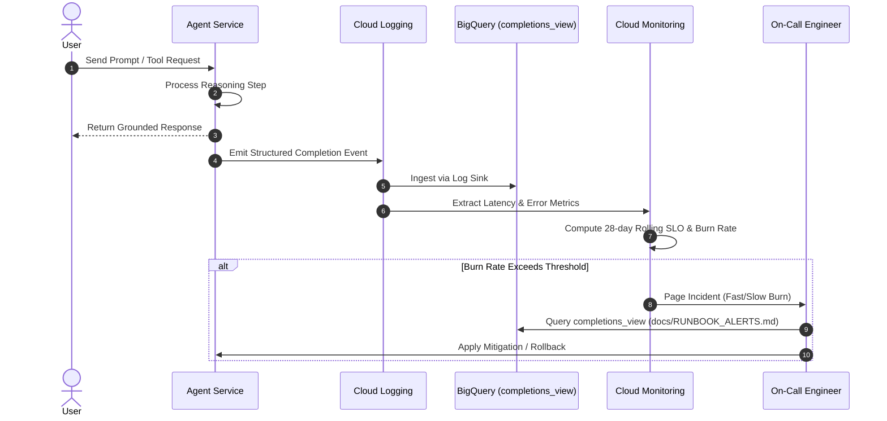

# Enterprise Agentic GitOps & DevOps Blueprint

A battle-tested, production-grade template and reference architecture for building, deploying, evaluating, and operating autonomous AI agents on Google Cloud Platform with end-to-end GitHub Actions GitOps automation.

---

## Architecture Overview

```mermaid
flowchart TD
    subgraph Developer_Experience["Developer Experience & GitOps Flow"]
        Dev[Engineer / Agent] -->|git push branch| PR[Pull Request Gate]
        PR --> G1[Gate 1: Lint & Code Style]
        PR --> G2[Gate 2: Terraform Plan Guard]
        PR --> G3[Gate 3: Unit & Integration Tests]
        PR --> G4[Gate 4: LLM-as-a-Judge Eval]
        PR --> G5[Gate 5: Frontend Build & Canvas Check]
        G1 & G2 & G3 & G4 & G5 -->|All 5 Pass + Branch Protection| Merge[Merge to main]
    end

    subgraph CI_CD["GitHub Actions Dual-SA Identity (WIF)"]
        PR -.->|Workload Identity Federation| CI_SA["CI Service Account (Read-Only)"]
        Merge -->|attribute.ref == refs/heads/main| Deployer_SA["Deployer Service Account (Full Deploy)"]
    end

    subgraph GCP["Google Cloud Platform Infrastructure"]
        Deployer_SA -->|Deploy / Mutate| RE["Vertex AI Reasoning Engine / Cloud Run"]
        Deployer_SA -->|Terraform State| TFState[("GCS Terraform State")]
        Deployer_SA -->|Schema Migrations| BQ[("BigQuery Lakehouse / Datasets")]
        
        RE -->|Raw Invocation Logs| Sink[("Cloud Logging Sink")]
        Sink -->|Layer 1: Raw Audit Logs| GCSLogs[("GCS Cold Audit Bucket")]
        Sink -->|Layer 1: Structured Telemetry| BQLog[("BigQuery completions_view")]
        
        BQLog -->|Log-Based Metrics| CloudMon["Cloud Monitoring & SRE Alerting"]
        CloudMon -->|Layer 2: 28-day Rolling SLOs| SLO[("Availability 99.5% / Latency p95")]
        CloudMon -->|Burn Rate Alert Policies| SRE_Alert["SRE Runbook Alerts (Fast & Slow Burn)"]
    end

    subgraph Security["Zero-Trust Data Boundary"]
        Client[End User / Agent Session] -->|Queries| AV["Authorized View (v_authorized_records)"]
        AV -->|SESSION_USER() Row Filter| BQ
    end
```

---

## The 10 Core Pillars

### 1. Two-Tier IAM & Keyless Workload Identity Federation (WIF)
Static service account JSON keys are strictly eliminated. Authentication is achieved exclusively through Google Cloud Workload Identity Federation:
- **CI Service Account (`*-ci`)**: Usable by any pull request in the repository. Restricted to read-only operations (`roles/viewer`, `roles/iam.securityReviewer`, `roles/bigquery.jobUser`, read-only access to Terraform remote state).
- **Deployer Service Account (`*-deployer`)**: Strictly locked at the Google Cloud IAM layer via CEL attribute condition:
  ```hcl
  attribute_condition = "assertion.repository == '${local.repository_full_name}'"
  principal_set_main  = "principalSet://iam.googleapis.com/${local.wif_pool_name}/attribute.ref/refs/heads/main"
  ```
  Only runs executing on `refs/heads/main` can impersonate the deployer service account to apply infrastructure changes and deploy agent runtimes.

### 2. Five Mandatory Pull Request Verification Gates
Branch protection guarantees that code cannot reach `main` without passing five parallel automated verification gates:
1. **`lint`**: Code formatting (`ruff format --check`), style and lint analysis (`ruff check`), and automated spelling verification (`codespell`).
2. **`terraform-plan`**: Read-only speculative plan guarded by `guard_terraform_plan.py` to prevent unauthorized resource destruction.
3. **`tests`**: Comprehensive unit test execution (`pytest tests/unit`) and end-to-end service integration tests.
4. **`evals`**: LLM-as-a-judge quality regression evaluation asserting factual grounding, tool selection, tone, and safety compliance.
5. **`frontend-build`**: Docker container build asserting embeddability, health checks, and canvas event compatibility.

### 3. Zero-Downtime Agent Deployment & Engine Triple-Pointer Sync
To prevent orphaned Reasoning Engine deployments or silent split-brain execution, three independent pointers are continuously verified via `deployment/ci/check_engine_consistency.py`:
1. `deployment/terraform/single-project/vars/env.tfvars` (`reasoning_engine_id`)
2. `agents/starter_agent/deployment_metadata.json` (`remote_agent_runtime_id`)
3. Terraform state output (`reasoning_engine_name`)

Deployments update in place without re-creating stateful resources. If pointers diverge, CI halts before applying changes.

### 4. Non-Destructive Terraform Plan Guard
Continuous Delivery applies infrastructure changes on merge to `main` without human intervention. The `deployment/ci/guard_terraform_plan.py` script inspects the speculative JSON execution plan:
- **Permitted**: Additive resources (`create`), in-place updates (`update`), safe IAM tightening (`create`, `delete` on non-pipeline bindings), and zero-downtime secret version rotation.
- **Blocked**: Destruction or replacement of stateful storage, databases, reasoning engines, or protected pipeline identities.
- **Emergency Override**: Destructive plans require explicitly setting `TF_ALLOW_DESTROY=true` in GitHub repository variables for a single run.

### 5. Production Two-Layer Telemetry & SRE Observability
A comprehensive observability architecture following Google Cloud Site Reliability Engineering (SRE) practices:
- **Layer 1 (Telemetry Persistence)**:
  - Immutable Cloud Storage cold audit bucket (`prevent_destroy = true`) retaining raw payload logs.
  - BigQuery `telemetry_logs` dataset with an optimized `completions_view` parsing latency, session IDs, status codes, and model usage.
- **Layer 2 (SRE Observability & Alerting)**:
  - 28-day rolling window Service Level Objectives (SLOs): 99.5% availability and p95 latency under 8000ms.
  - Multi-window multi-burn-rate alerting: Fast-burn (1-hour window, 14.4x burn rate) and slow-burn (6-hour window, 6x burn rate) policies.
  - Cloud Monitoring alert policies with direct links to [`docs/RUNBOOK_ALERTS.md`](docs/RUNBOOK_ALERTS.md).
  - Automated Cloud Run / Reasoning Engine uptime health checks.



### 6. Zero-Trust Row-Level Security in BigQuery
Data tier security is built upon a 4-tier zero-trust view architecture (`data/views/10_v_authorized_records.sql`):
- Session extraction via `LOWER(TRIM(SESSION_USER()))`.
- Strict null handling via `NULLIF()`.
- `WHERE EXISTS` security join against user entitlement tables.
- Base tables are locked and inaccessible to client queries; access is mediated entirely through the authorized view.

### 7. LLM-as-a-Judge Regression Evaluation Framework
An automated evaluation harness (`tests/eval/`):
- Configurable thresholds in [`tests/eval/eval_config.yaml`](tests/eval/eval_config.yaml) for mean score floor, single-case score floor, error rates, and zero-tolerance safety guardrails.
- Robust evaluation runner [`tests/eval/response_quality.py`](tests/eval/response_quality.py) with judge model fallback: `gemini-2.5-pro` transitioning gracefully to `gemini-2.5-flash`.
- Offline fallback (`AGENT_EVAL_MOCK=1`) for hermetic local test runs and air-gapped environments.
- Generates formatted GitHub Actions step summaries (`check_thresholds.py`).

### 8. Sandboxed Offline Automated Code Repair (CodeMender)
The `codemender/` suite provides an offline, self-contained automated repair loop:
- Enforces `--no-model-fallback` to ensure predictability.
- Powered by `gemini-2.5-pro` for deep code analysis and refactoring.
- Automated validation via `codemender/build.sh`, executing syntax validation, ruff lint checks, unit tests, and terraform format verification.

### 9. Enterprise Frontend Canvas & postMessage Protocol
The interactive web canvas (`frontend/`):
- Implements secure, sandboxed `postMessage` bidirectional event communication.
- Supports typed actions: `type: 'agent_action'` and `CANVAS_ACTION`.
- Containerized via high-performance Nginx with security headers, embeddable in portals, dashboards, or iframe hosts.

### 10. Automated Project Management & Kanban Automation
The `project_board_sync.yaml` workflow synchronizes GitHub issues and pull requests to GitHub ProjectV2 columns via the GraphQL API:
- `Backlog`: Newly created issues.
- `Ready (Pick Next)`: Issues marked ready for development.
- `In Progress`: Issues associated with active feature branches.
- `In Review (PR Open)`: Issues linked to open pull requests.
- `Done`: Closed issues and merged pull requests.

---

## Directory Structure

```
agentic-gitops-devops-blueprint/
├── .github/
│   ├── dependabot.yml                  # Multi-ecosystem dependency management with cooldowns
│   ├── pull_request_template.md        # PR template with 5 required gate checks
│   └── workflows/
│       ├── pr_checks.yaml              # PR validation pipeline (Lint, TF Plan, Test, Eval, Build)
│       ├── release.yaml                # Continuous Deployment on main (Apply, Test, Eval, Deploy, Smoke)
│       └── project_board_sync.yaml     # GitHub ProjectV2 Kanban synchronization
├── agents/
│   └── starter_agent/                  # Production FastAPI agent with Google GenAI SDK
│       ├── app.py                      # Application entrypoint with structured logging
│       ├── deployment_metadata.json    # Reasoning Engine triple-pointer tracking
│       └── Dockerfile                  # Container definition for agent runtime
├── codemender/                         # Sandboxed automated code repair
│   ├── build.sh                        # Verification script (Ruff, Pytest, Terraform fmt)
│   ├── cm.sh                           # CodeMender invocation runner
│   └── config.yaml                     # Repair configuration
├── data/
│   ├── README.md                       # Data layer documentation & 4-tier view pattern
│   └── views/
│       └── 10_v_authorized_records.sql # BigQuery zero-trust authorized view with SESSION_USER()
├── deployment/
│   ├── bootstrap.sh                    # End-to-end bootstrap for state bucket and initial plan
│   ├── ci/
│   │   ├── guard_terraform_plan.py     # Fails PRs if plan proposes destructive changes
│   │   └── check_engine_consistency.py # Verifies Reasoning Engine triple-pointer
│   ├── register_ge_oauth.py            # Gemini Enterprise OAuth registration utility
│   └── terraform/
│       ├── single-project/             # GCP infrastructure (WIF, SAs, BigQuery, GCS, Secrets, SLOs)
│       └── github/                     # GitHub Secrets, Variables, Environment, Branch Protection
├── docs/
│   └── RUNBOOK_ALERTS.md               # SRE alert triage runbook with LQL and BigQuery SQL queries
├── frontend/                           # Interactive iframe canvas with postMessage protocol
│   ├── Dockerfile
│   ├── index.html
│   └── nginx.conf
├── prompts/
│   └── BOOTSTRAP_NEW_PROJECT_PROMPT.md # LLM prompting instructions for bootstrapping new projects
├── skills/
│   └── gitops-devops-bootstrap/
│       └── SKILL.md                    # Standard operating skill guide for blueprint setup
├── tests/
│   ├── ci/preflight_bq_access.py       # BigQuery client connectivity validation
│   ├── eval/                           # LLM-as-a-judge quality and safety evaluation suite
│   │   ├── check_thresholds.py         # Summary renderer and threshold evaluator
│   │   ├── eval_config.yaml            # Quality, safety, and latency thresholds
│   │   └── response_quality.py         # Judge execution harness with model fallback
│   ├── load_test/                      # Locust concurrent load testing suite
│   │   ├── README.md
│   │   └── load_test.py
│   ├── unit/                           # Security, telemetry, and guardrail unit tests
│   │   ├── test_check_thresholds.py
│   │   ├── test_observability.py
│   │   ├── test_response_quality.py
│   │   ├── test_security.py
│   │   ├── test_security_and_observability.py
│   │   └── test_terraform_guards.py
│   └── integration/                    # End-to-end agent service integration tests
│       └── test_agent.py
├── pyproject.toml                      # PEP 621 packaging, Ruff, Pytest, and Codespell configuration
├── AGENTS.md                           # Operational law and binding rules for AI agents
├── GEMINI.md                           # Developer guidelines and architectural standards
└── .pre-commit-config.yaml             # Local pre-commit hook configuration
```

---

## Quickstart & Bootstrap Guide

### 1. Prerequisites
- Python 3.11+ with `uv` installed (`pip install uv`)
- Google Cloud SDK (`gcloud`) authenticated (`gcloud auth login` and `gcloud auth application-default login`)
- Terraform 1.7+
- GitHub CLI (`gh`) authenticated with repository administration privileges

### 2. Bootstrapping a New Agent Project
Run the automated bootstrap script to initialize the remote Terraform state bucket and speculatively plan the initial environment:

```bash
chmod +x ./deployment/bootstrap.sh
./deployment/bootstrap.sh \
  --project-id="your-gcp-project-id" \
  --repo-owner="your-github-org" \
  --repo-name="your-repo-name"
```

### 3. Applying GitHub Repository Settings
Apply the Terraform GitHub module to register Workload Identity Federation variables, repository secrets, and branch protection rules:

```bash
cd deployment/terraform/github
terraform init -backend-config="bucket=your-gcp-project-id-tfstate"
terraform apply -var-file=vars/env.tfvars
```

### 4. Running Local Verification Suites
Run the exact check suites executed by the CI pipeline before pushing changes:

```bash
# 1. Format and lint checks
uv run ruff format --check .
uv run ruff check .
uv run codespell .

# 2. Run unit and integration tests (with offline evaluation mock enabled)
AGENT_EVAL_MOCK=1 uv run pytest tests/unit tests/integration -v

# 3. Execute the full offline CodeMender build verification
bash ./codemender/build.sh
```

---

## Operational Runbooks & Guidance

- **Alert Triage**: When SRE alert policies trigger, follow the step-by-step diagnostic workflows in [`docs/RUNBOOK_ALERTS.md`](docs/RUNBOOK_ALERTS.md).
- **AI Agent Laws**: AI coding assistants modifying this repository must adhere strictly to the rules documented in [`AGENTS.md`](AGENTS.md).
- **Project Bootstrapping**: To bootstrap a new microservice or agent from this template using an LLM, refer to [`prompts/BOOTSTRAP_NEW_PROJECT_PROMPT.md`](prompts/BOOTSTRAP_NEW_PROJECT_PROMPT.md) and [`skills/gitops-devops-bootstrap/SKILL.md`](skills/gitops-devops-bootstrap/SKILL.md).

---

## License & Attribution

Copyright 2026 The Project Contributors. Licensed under the Apache License, Version 2.0. See [`LICENSE`](LICENSE) and [`NOTICE`](NOTICE) for details.

Original and continuing authors are credited in [`CONTRIBUTORS.md`](CONTRIBUTORS.md).
