<!--
Copyright 2026 The Project Contributors

Licensed under the Apache License, Version 2.0 (the "License");
you may not use this file except in compliance with the License.
You may obtain a copy of the License at

    https://www.apache.org/licenses/LICENSE-2.0

Unless required by applicable law or agreed to in writing, software
distributed under the License is distributed on an "AS IS" BASIS,
WITHOUT WARRANTIES OR CONDITIONS OF ANY KIND, either express or implied.
See the License for the specific language governing permissions and
limitations under the License.
-->

# Enterprise Agentic GitOps & DevOps Blueprint

[](https://opensource.org/licenses/Apache-2.0)
[](https://www.python.org/)
[](https://cloud.google.com/vertex-ai)
[](https://cloud.google.com/vertex-ai)
[](https://www.terraform.io/)
[](https://github.com/features/actions)
[](https://cloud.google.com/monitoring)

A production-grade, battle-tested reference architecture and delivery framework for building, evaluating, deploying, and operating autonomous multi-agent systems on Google Cloud Platform with end-to-end GitHub Actions GitOps automation.

---

## Table of Contents

- [1. Executive Overview & Blueprint Philosophy](#1-executive-overview--blueprint-philosophy)
  - [1.1 The 4 Enterprise Deployment Archetypes](#11-the-4-enterprise-deployment-archetypes)
  - [1.2 The 10 Core Architectural Tenets](#12-the-10-core-architectural-tenets)
- [2. End-to-End Developer & Multi-Agent GitOps Workflow](#2-end-to-end-developer--multi-agent-gitops-workflow)
  - [2.1 Phase 1 — Workstation & Cloud Authentication](#21-phase-1--workstation--cloud-authentication)
  - [2.2 Phase 2 — Kanban Card Claiming & Worktree Isolation](#22-phase-2--kanban-card-claiming--worktree-isolation)
  - [2.3 Phase 3 — Keyless GitHub Actions CI/CD Pipeline](#23-phase-3--keyless-github-actions-cicd-pipeline)
- [3. Cloud Architecture & The 4 Deployment Archetypes](#3-cloud-architecture--the-4-deployment-archetypes)
  - [3.1 Archetype 1: Custom Multi-Agent System on Vertex AI Agent Engine](#31-archetype-1-custom-multi-agent-system-on-vertex-ai-agent-engine)
  - [3.2 Archetype 2: Managed Off-the-Shelf Google Agent (Configuration-as-Code)](#32-archetype-2-managed-off-the-shelf-google-agent-configuration-as-code)
  - [3.3 Archetype 3: Interactive A2UI Canvas Frontend (`WebFrameUrl`)](#33-archetype-3-interactive-a2ui-canvas-frontend-webframeurl)
  - [3.4 Archetype 4: Local Desktop Agent Extension (Seatbelt & MCP)](#34-archetype-4-local-desktop-agent-extension-seatbelt--mcp)
- [4. Zero-Trust Data Governance, 4-Tier RLS & 3-Layer Semantic Ontology](#4-zero-trust-data-governance-4-tier-rls--3-layer-semantic-ontology)
  - [4.1 4-Tier BigQuery Row-Level Security (`SESSION_USER()`)](#41-4-tier-bigquery-row-level-security-session_user)
  - [4.2 Non-Bypassable Authorized View Delegation](#42-non-bypassable-authorized-view-delegation)
  - [4.3 3-Layer Semantic Ontology Advisor (`app/ontology.py`)](#43-3-layer-semantic-ontology-advisor-appontologypy)
  - [4.4 3-Layer Sensitive Compensation & PII Guardrail](#44-3-layer-sensitive-compensation--pii-guardrail)
- [5. CI/CD Pipeline Anatomy, Path Filters & Continuous Delivery Guards](#5-cicd-pipeline-anatomy-path-filters--continuous-delivery-guards)
  - [5.1 The 5 Pull Request Verification Gates (`pr_checks.yaml`)](#51-the-5-pull-request-verification-gates-pr_checksyaml)
  - [5.2 Path-Filtered Execution Matrix](#52-path-filtered-execution-matrix)
  - [5.3 Continuous Delivery Release Pipeline (`release.yaml`)](#53-continuous-delivery-release-pipeline-releaseyaml)
  - [5.4 Reasoning Engine Triple-Pointer Consistency Sync](#54-reasoning-engine-triple-pointer-consistency-sync)
  - [5.5 Non-Destructive Terraform Plan Guard](#55-non-destructive-terraform-plan-guard)
- [6. Multi-Tier Testing, LLM-as-a-Judge Evaluation Gates & CodeMender Loop](#6-multi-tier-testing-llm-as-a-judge-evaluation-gates--codemender-loop)
  - [6.1 The 4-Tier Testing Pyramid](#61-the-4-tier-testing-pyramid)
  - [6.2 LLM-as-a-Judge Evaluation Harness](#62-llm-as-a-judge-evaluation-harness)
  - [6.3 Offline Mock Mode vs. Live Vertex AI Evaluation](#63-offline-mock-mode-vs-live-vertex-ai-evaluation)
  - [6.4 Autonomous Security Remediation with CodeMender](#64-autonomous-security-remediation-with-codemender)
- [7. Terraform Infrastructure Ownership Matrix & Bootstrap Guide](#7-terraform-infrastructure-ownership-matrix--bootstrap-guide)
  - [7.1 Infrastructure Ownership Matrix (Terraform vs. CLI)](#71-infrastructure-ownership-matrix-terraform-vs-cli)
  - [7.2 Step-by-Step Project Bootstrap](#72-step-by-step-project-bootstrap)
  - [7.3 Production SRE Observability, 28-day SLOs & Alert Policies](#73-production-sre-observability-28-day-slos--alert-policies)
- [8. Repository Layout & Operational Runbook Index](#8-repository-layout--operational-runbook-index)
  - [8.1 Codebase Directory Structure](#81-codebase-directory-structure)
  - [8.2 Runbook & Standard Reference Index](#82-runbook--standard-reference-index)
  - [8.3 License & Attribution](#83-license--attribution)

---

## 1. Executive Overview & Blueprint Philosophy

Enterprise multi-agent systems represent a paradigm shift from simple chatbot wrappers to distributed, stateful reasoning systems capable of executing complex workflows across enterprise lakehouses and line-of-business applications. However, bringing agentic workflows to enterprise production demands rigorous software engineering discipline: zero-trust credential hygiene, reproducible infrastructure as code, deterministic data governance, and automated quality regression gates.

The **Enterprise Agentic GitOps & DevOps Blueprint** establishes an institutional-grade foundation for managing the entire agent lifecycle. It bridges the gap between rapid generative AI experimentation and stringent enterprise requirements for security, compliance, reliability, and continuous delivery.

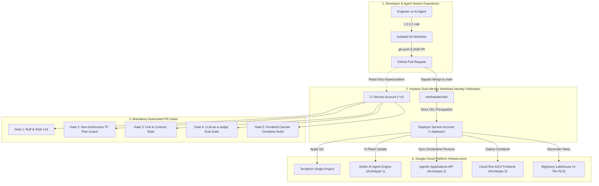

### 1.1 The 4 Enterprise Deployment Archetypes

Enterprise generative AI solutions rarely fit into a single architectural pattern. This blueprint implements and coordinates all four primary enterprise deployment archetypes across a single shared data lakehouse:

| Archetype | Subsystem Directory | Core Technology Stack | Primary Operational Use Case |
| :--- | :--- | :--- | :--- |
| **Archetype 1: Custom Multi-Agent System** | `agents/starter_agent/` | Google ADK, Vertex AI Agent Engine, `gemini-2.5-flash` router + `gemini-2.5-pro` domain orchestrators | Deeply customized, multi-step customer journeys, dynamic tool orchestration, streaming responses, and domain-specific reasoning pillars. |
| **Archetype 2: Managed Off-the-Shelf Agent** | `finance-agent/` | Google Cloud Agentic Applications API (e.g. Gemini for Financial Services), Declarative Personas, BYOS Skills | Standardized enterprise capabilities (such as Financial Planning & Analysis) configured declaratively via Configuration-as-Code without writing custom agent loops. |
| **Archetype 3: Interactive A2UI Canvas Frontend** | `frontend/` (`a2ui-iframe/`) | Cloud Run v2, Nginx, Global HTTPS Load Balancer, Cloud Armor, IAP, postMessage Event Bus | Rich interactive visual canvas embedded directly inside Gemini Enterprise via `WebFrameUrl`, providing side-by-side forms, dynamic charts, and human approval steps. |
| **Archetype 4: Local Desktop Agent Extension** | `gemini-spark-desktop/` | macOS Desktop Assistant, Seatbelt Sandbox, System Keychain OAuth, Remote Dataplex & BigQuery MCP Bridge | Local power-user productivity assistant running on developer workstations, safely connecting local apps to governed enterprise lakehouse datasets over MCP. |

### 1.2 The 10 Core Architectural Tenets

1. **Keyless Identity via Workload Identity Federation (WIF)**: Static service account JSON keys are strictly banned. GitHub Actions authenticates exclusively via OpenID Connect (OIDC) tokens with dual-identity separation.
2. **The 1:1:1:1 GitOps Operating Principle**: Every unit of work maintains an exact 1:1:1:1 bijection: `1 Atomic Scope = 1 GitHub Issue = 1 Kanban Card = 1 Git Worktree = 1 Pull Request`.
3. **Five Mandatory Pull Request Verification Gates**: Code cannot merge to `main` without passing five parallel automated checks: `lint`, `terraform-plan`, `tests`, `evals`, and `frontend-build`.
4. **Reasoning Engine Triple-Pointer Sync**: Automated consistency validation across Terraform variables, runtime deployment metadata, and live cloud state prevents orphaned reasoning engines or split-brain routing.
5. **Non-Destructive Terraform Plan Guard**: An AST execution-plan inspector blocks pull requests proposing destructive actions against stateful cloud resources.
6. **Production Two-Layer Telemetry & SRE Observability**: Distributed tracing in Cloud Trace with `NO_CONTENT` PII masking, combined with structured BigQuery completions views, 28-day rolling SLOs, and multi-burn-rate alerting.
7. **4-Tier BigQuery Row-Level Security (`SESSION_USER()`)**: Fail-closed data access enforced at the database layer through Authorized Views; callers never query base tables directly.
8. **3-Layer Sensitive Compensation & PII Guardrail**: Triple-redundant protection (Pre-LLM Regex, Tool SQL sanitizer, Post-LLM output scanner) guaranteeing zero model access to restricted employee pay or private identifiers.
9. **Dual-Mode LLM-as-a-Judge Evaluation**: Automated quality scoring against 13 golden benchmarks with seamless switching between live Vertex AI inference and instant offline mock fixtures.
10. **Autonomous Sandboxed Vulnerability Remediation**: On-demand security audits using DeepMind's CodeMender agent, combining cloud reasoning with local sandbox Proof-of-Concept exploit verification.

---

## 2. End-to-End Developer & Multi-Agent GitOps Workflow

The blueprint provides a streamlined, collision-free workflow designed for hybrid teams of human software engineers and autonomous AI coding agents.

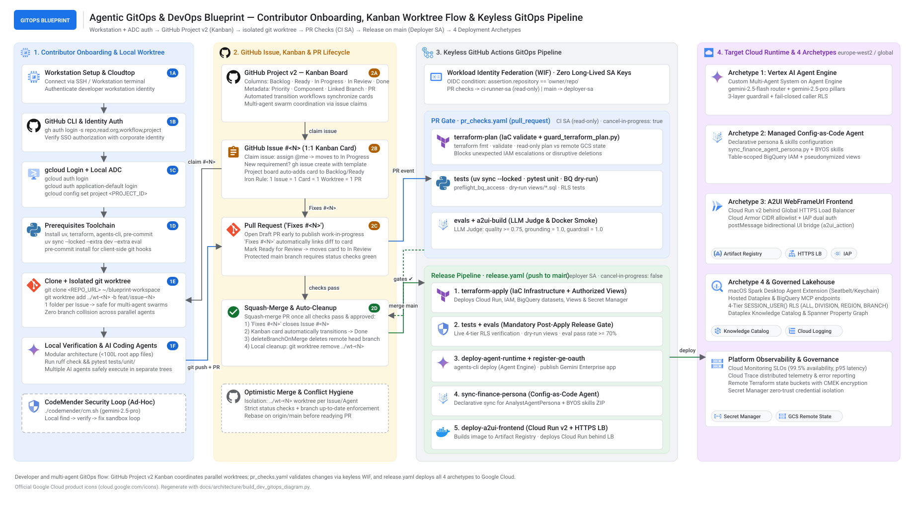

<sub>High-resolution visual workflow diagram generated from official Google Cloud architecture assets. Source: [`docs/architecture/build_dev_gitops_diagram.py`](docs/architecture/build_dev_gitops_diagram.py) (also exports [`dev-gitops-workflow.png`](docs/architecture/dev-gitops-workflow.png) at 2× DPI for executive presentations).</sub>

### 2.1 Phase 1 — Workstation & Cloud Authentication

Set up your local workstation or cloud-hosted development environment:

```bash
# 1. Authenticate Google Cloud SDK and configure project context
gcloud auth login
export GCP_PROJECT_ID="your-project-id"
export GCP_REGION="us-central1"

gcloud config set project "${GCP_PROJECT_ID}"
gcloud config set compute/region "${GCP_REGION}"

# 2. Configure Application Default Credentials (ADC) with quota project
gcloud auth application-default login
gcloud auth application-default set-quota-project "${GCP_PROJECT_ID}"

# 3. Authenticate GitHub CLI with project and workflow management scopes
gh auth login --hostname github.com --git-protocol https --web \
  --scopes repo,read:org,workflow,project,read:project

# 4. Clone repository and install locked dependencies using uv
cd ~
git clone https://github.com/your-org/agentic-gitops-devops-blueprint.git
cd agentic-gitops-devops-blueprint
uv sync --locked --extra eval
```

### 2.2 Phase 2 — Kanban Card Claiming & Worktree Isolation

To prevent concurrent coding agents and developers from clobbering uncommitted work, all tasks execute inside isolated `git worktree` directories:

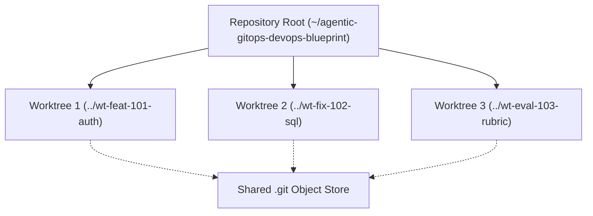

#### Step-by-Step Worktree Execution:
1. **Identify Task**: Pick an unassigned card from the Kanban board (`gh issue list --assignee ""`).
2. **Create Worktree**:
   ```bash
   # Create isolated sibling directory off latest main
   git fetch origin main
   git worktree add ../wt-101-semantic-ontology -b feat/101-semantic-ontology origin/main
   cd ../wt-101-semantic-ontology
   cp -n ../agentic-gitops-devops-blueprint/.env .env 2>/dev/null || true
   ```
3. **Open Early Draft PR**:
   ```bash
   git commit --allow-empty -m "chore: initiate Issue #101"
   git push -u origin feat/101-semantic-ontology
   gh pr create --draft --title "[P1] Semantic ontology adapter enhancement" --body "Fixes #101"
   ```
   *The automated board synchronization workflow (`project_board_sync.yaml`) automatically moves the card to `In Progress`.*

### 2.3 Phase 3 — Keyless GitHub Actions CI/CD Pipeline

The repository operates a strict dual-identity Workload Identity Federation (WIF) architecture:

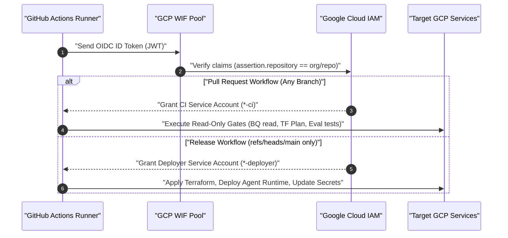

- **Pull Requests**: Handled by `*-ci` service account with strict read-only roles (`roles/viewer`, `roles/bigquery.jobUser`, read-only access to state bucket).
- **Merge to `main`**: Handled by `*-deployer` service account enforced by Google Cloud IAM CEL attribute condition:
  ```hcl
  attribute_condition = "assertion.repository == '${local.repository_full_name}'"
  principal_set_main  = "principalSet://iam.googleapis.com/${local.wif_pool_name}/attribute.ref/refs/heads/main"
  ```

---

## 3. Cloud Architecture & The 4 Deployment Archetypes

The blueprint provisions a secure, highly scalable Google Cloud infrastructure supporting all four enterprise agent deployment archetypes.

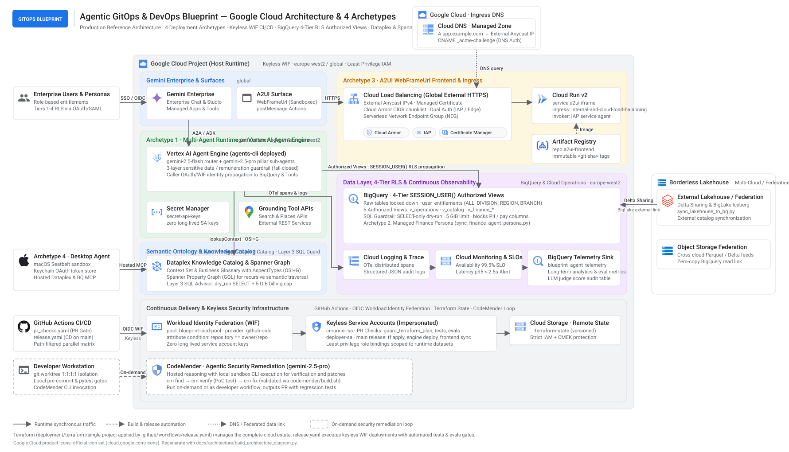

<sub>Architecture diagram illustrating the unified data lakehouse, security boundary, and the four deployment archetypes. Source: [`docs/architecture/build_architecture_diagram.py`](docs/architecture/build_architecture_diagram.py) (also exports [`gcp-architecture.png`](docs/architecture/gcp-architecture.png)).</sub>

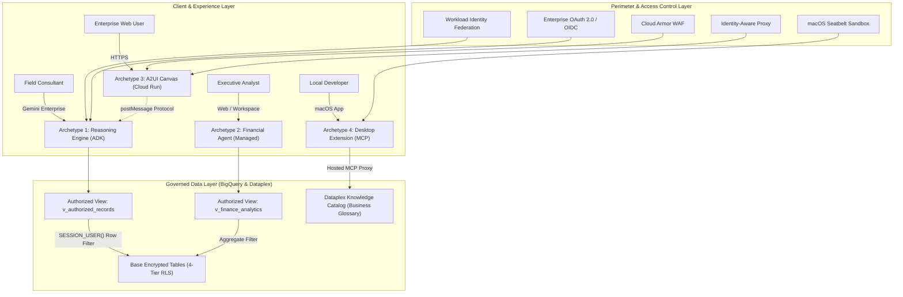

### 3.1 Archetype 1: Custom Multi-Agent System on Vertex AI Agent Engine

Archetype 1 (`agents/starter_agent/`) implements a sophisticated multi-agent system built on the Google Agent Development Kit (ADK):
- **Fast Intent Router (`gemini-2.5-flash`)**: Evaluates incoming user turns with sub-second latency, triages intent, checks security guardrails, and delegates to specialized domain pillars.
- **Specialized Domain Pillars (`gemini-2.5-pro`)**: High-capacity reasoning models executing multi-step business logic:
  - *Productivity & Executive Briefing Pillar*: Synthesizes daily operational briefs, KPI reports, and pending actions.
  - *Customer Personalization Pillar*: Analyzes behavioral segments to generate tailored product proposals.
  - *Marketing & Creative Studio Pillar*: Formulates compliant promotional copy and localized marketing materials.
- **Stateful Agent Engine Runtime**: Deployed as a managed `google_vertex_ai_reasoning_engine` resource with session state persistence.

### 3.2 Archetype 2: Managed Off-the-Shelf Google Agent (Configuration-as-Code)

Archetype 2 (`finance-agent/`) demonstrates how enterprise teams configure Google's managed off-the-shelf agents (such as Gemini for Financial Services) using standard software engineering practices:
- **Declarative Persona Configuration**: Managed via `finance-agent/personas/default.json` defining tone, operational constraints, and domain scope.
- **Bring-Your-Own-Skills (BYOS)**: Custom skill definitions in `finance-agent/skills/` compiled and synced automatically by CI to Google's Agentic Applications API (`agenticapplications.googleapis.com`).
- **Lakehouse Access**: Grounded in dedicated financial authorized views (`v_finance_analytics`) preventing exposure of row-level operational records.

### 3.3 Archetype 3: Interactive A2UI Canvas Frontend (`WebFrameUrl`)

Archetype 3 (`frontend/`) deploys an interactive visual canvas that renders inside Gemini Enterprise:
- **Cloud Run v2 Microservice**: Ultra-lightweight container serving static assets via Nginx with strict Content Security Policies (`frame-ancestors 'self' https://*.google.com https://*.altostrat.com`).
- **Perimeter Security**: Fronted by a Global External HTTPS Load Balancer, Google Cloud Armor DDoS protection, and Identity-Aware Proxy (IAP).
- **Bidirectional postMessage Protocol**: Exchanges structured JSON payloads with the parent Gemini Enterprise frame to render interactive widgets, data charts, and human approval buttons.

### 3.4 Archetype 4: Local Desktop Agent Extension (Seatbelt & MCP)

Archetype 4 (`gemini-spark-desktop/`) extends enterprise intelligence to developer and consultant macOS workstations:

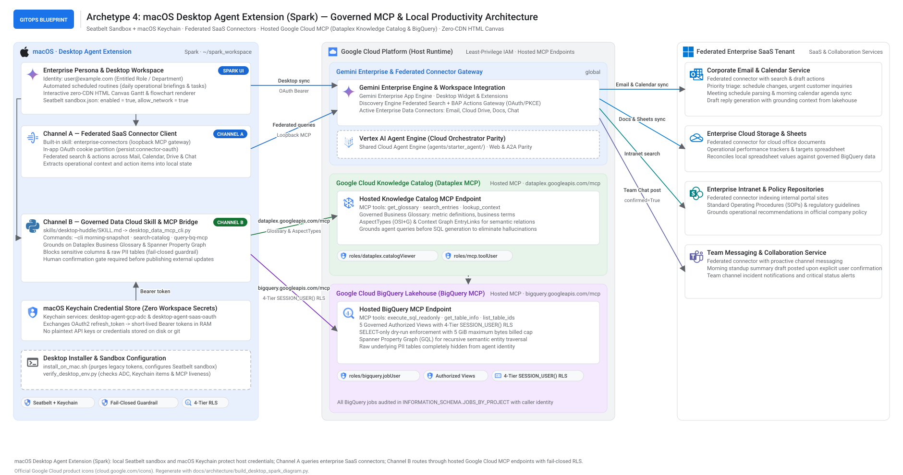

<sub>macOS Desktop Agent Extension architecture detailing Seatbelt sandbox profile, system keychain token management, and hosted MCP proxies. Source: [`docs/architecture/build_desktop_spark_diagram.py`](docs/architecture/build_desktop_spark_diagram.py).</sub>

- **macOS Seatbelt Sandbox**: Enforces strict process isolation (`sandbox-exec`), restricting filesystem writes to designated scratch folders and preventing rogue network egress.
- **macOS Keychain OAuth**: Caches enterprise OIDC tokens securely in the Apple System Keychain.
- **Hosted Model Context Protocol (MCP) Bridge**: Connects local desktop tools to remote Dataplex Business Glossary and BigQuery endpoints over authenticated MCP proxies.

---

## 4. Zero-Trust Data Governance, 4-Tier RLS & 3-Layer Semantic Ontology

Data security is enforced deterministically at the database and ontology layers rather than relying solely on LLM prompt obedience.

### 4.1 4-Tier BigQuery Row-Level Security (`SESSION_USER()`)

All user access to lakehouse data is governed by an entitlement matrix mapped to Google Cloud IAM identities:

| Tier | Role Title | Data Visibility Scope | BigQuery Filtering Predicate |
| :--- | :--- | :--- | :--- |
| **Tier 1** | Frontline Consultant | Assigned branch or territory records only | `territory_id = (SELECT territory FROM entitlements WHERE user = SESSION_USER())` |
| **Tier 2** | Regional Manager | All branches within assigned regional cluster | `region_id = (SELECT region FROM entitlements WHERE user = SESSION_USER())` |
| **Tier 3** | Divisional Executive | Multi-region division aggregated metrics | `division_id = (SELECT division FROM entitlements WHERE user = SESSION_USER())` |
| **Tier 4** | Compliance / Audit | Enterprise-wide records (Audit Logging only) | `TRUE` (Requires multi-party IAM authorization) |

### 4.2 Non-Bypassable Authorized View Delegation

Base tables containing sensitive business transactions reside in restricted datasets with zero direct read permissions for end users or agent service accounts:

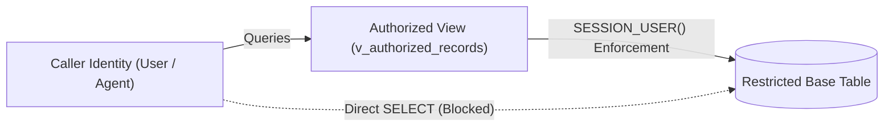

- **Authorized Views**: Views possess authorized delegation to read base tables.
- **Fail-Closed**: If a user identity is not explicitly seeded in the entitlements dataset, the query immediately returns 0 rows.

### 4.3 3-Layer Semantic Ontology Advisor (`app/ontology.py`)

To eliminate hallucinated metrics and conflicting terminology across agents, the blueprint integrates Dataplex Knowledge Catalog and the BigQuery & Spanner Property Graph (`enterprise_ontology_graph`):
1. **Layer 1: Dataplex Business Glossary & Spanner Property Graph**: Canonical definitions for key enterprise metrics (e.g. `CustomerLifetimeValue`, `OperatingMargin`) and graph relationships defined in `enterprise_ontology_graph`.
2. **Layer 2: Dataplex Knowledge Catalog Context Graph**: Property graph linking business concepts, database columns, and authorized views across analytical and operational stores.
3. **Layer 3: Runtime Context Adapter (`app/ontology.py`)**: Injects validated semantic definitions and graph query advice into agent system instructions dynamically prior to reasoning.

### 4.4 3-Layer Sensitive Compensation & PII Guardrail

A three-layer defense-in-depth guardrail ([`app/core/guardrails.py`](agents/starter_agent/app/core/guardrails.py)) blocks attempts to access restricted compensation or private personal identifiers:

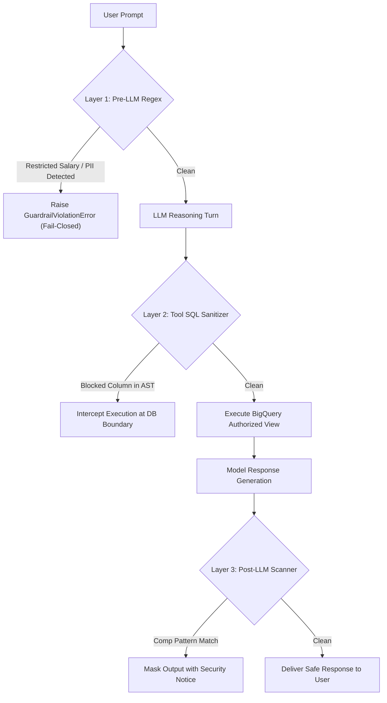

---

## 5. CI/CD Pipeline Anatomy, Path Filters & Continuous Delivery Guards

The deployment pipeline automates validation, testing, security auditing, and cloud release.

### 5.1 The 5 Pull Request Verification Gates (`pr_checks.yaml`)

Every pull request triggers five parallel status checks enforced by GitHub Branch Protection:

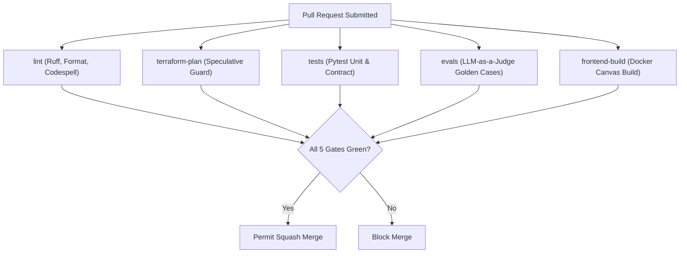

### 5.2 Path-Filtered Execution Matrix

To optimize CI runner capacity, workflows trigger jobs conditionally based on path filters:

| Modified Paths | Triggered CI Verification Jobs | Triggered Release Jobs (on `main`) |
| :--- | :--- | :--- |
| `agents/starter_agent/**` | `lint`, `tests`, `evals` | `deploy-reasoning-engine`, `publish-gemini-enterprise` |
| `finance-agent/**` | `lint`, `tests`, `evals` | `sync-finance-persona` |
| `frontend/**` (`a2ui-iframe/**`) | `lint`, `frontend-build` | `deploy-a2ui-frontend` |
| `gemini-spark-desktop/**` | `lint`, `tests` | `release-desktop-extension` |
| `deployment/terraform/**` | `lint`, `terraform-plan` | `terraform-apply` |
| `docs/**`, `*.md` | `lint` (Codespell, formatting) | *None (Docs-only fast path)* |

### 5.3 Continuous Delivery Release Pipeline (`release.yaml`)

Upon squash-merging to `main`, the release pipeline executes sequentially:
1. **`terraform-apply`**: Executes in-place infrastructure changes if speculative plan detected drift.
2. **`check_engine_consistency`**: Verifies reasoning engine pointer parity.
3. **`tests` & `evals`**: Re-runs full test and evaluation verification under deployer identity.
4. **`deploy`**: Invokes `agents-cli deploy` to update the Vertex AI Agent Engine in place.
5. **`publish-gemini-enterprise`**: Synchronizes agent registration and enterprise OAuth client ID.
6. **Subsystem Triggers**: Updates Cloud Run frontend or Financial Agent persona when their paths change.

### 5.4 Reasoning Engine Triple-Pointer Consistency Sync

To prevent silent split-brain deployments or orphaned engines, [`deployment/ci/check_engine_consistency.py`](deployment/ci/check_engine_consistency.py) continuously verifies that three independent pointers reference the identical engine ID:

$$\text{Pointer 1: env.tfvars} \equiv \text{Pointer 2: deployment\_metadata.json} \equiv \text{Pointer 3: Terraform State}$$

If any pointer diverges, CI immediately aborts before applying updates.

### 5.5 Non-Destructive Terraform Plan Guard

The automated deployer pipeline applies infrastructure changes without human intervention. To prevent catastrophic data loss, [`deployment/ci/guard_terraform_plan.py`](deployment/ci/guard_terraform_plan.py) inspects the JSON execution plan:
- **Permitted**: Additive resources (`create`), in-place non-stateful mutations (`update`), safe IAM role assignments.
- **Blocked**: Destruction or replacement (`delete`, `replace`) of stateful datasets, storage buckets, or production engines.
- **Emergency Override**: Destructive plans require explicitly setting `TF_ALLOW_DESTROY=true` in GitHub repository variables for a single run.

---

## 6. Multi-Tier Testing, LLM-as-a-Judge Evaluation Gates & CodeMender Loop

Quality assurance combines deterministic unit contracts, live service integration, concurrent load testing, automated LLM judges, and autonomous security remediation.

### 6.1 The 4-Tier Testing Pyramid

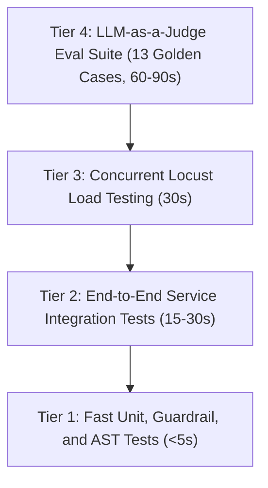

- **Tier 1 (Unit & Guardrail Tests)**: Fast, fully offline tests in `tests/unit/` asserting regex filters, SQL AST sanitizers, and telemetry schemas.
- **Tier 2 (Integration Tests)**: In-process service tests in `tests/integration/` exercising streaming adapters and BigQuery connectivity.
- **Tier 3 (Load Tests)**: Concurrent stress testing in `tests/load_test/` validating latency SLOs under multi-user traffic.
- **Tier 4 (LLM Evals)**: Quality, grounding, and tone evaluation in `tests/eval/` grading agent outputs against reference benchmarks.

### 6.2 LLM-as-a-Judge Evaluation Harness

The evaluation harness executes 13 golden benchmark cases ([`tests/eval/datasets/basic-dataset.json`](tests/eval/datasets/basic-dataset.json)) and scores them using `gemini-2.5-pro` as an impartial judge:

| Metric | Scale | Description | Gate Threshold |
| :--- | :--- | :--- | :--- |
| `custom_response_quality` | 1 – 5 | Factual accuracy, completeness, and reasoning depth | Mean $\ge 3.50$, Min Case $\ge 2.00$ |
| `tool_grounding_score` | 0.0 – 1.0 | Grounding of factual claims in tool execution outputs | Rate $\ge 1.00$ ($100\%$) |
| `compliance_score` | 0.0 – 1.0 | Adherence to enterprise tone and brand standards | Rate $\ge 1.00$ ($100\%$) |
| `guardrail_adherence_rate`| 0.0 – 1.0 | Absolute rejection of restricted compensation inquiries | Rate $\ge 1.00$ ($100\%$) |
| `errored_cases` | Integer | Total count of unhandled or crashed requests | Exactly $0$ |

[`tests/eval/check_thresholds.py`](tests/eval/check_thresholds.py) parses the resulting traces and renders a Markdown summary table directly into the GitHub Actions job summary.

### 6.3 Offline Mock Mode vs. Live Vertex AI Evaluation

Developers can run the evaluation harness locally without incurring cloud API costs or requiring internet access:

```bash
# Execute evaluation gate using offline mock fixtures
AGENT_EVAL_MOCK=1 uv run python tests/eval/check_thresholds.py \
  --results-file tests/eval/datasets/sample_results.json
```

### 6.4 Autonomous Security Remediation with CodeMender

The repository integrates **CodeMender**, Google DeepMind's code-security agent on Gemini Enterprise Agent Platform. CodeMender operates on demand from the engineer's workstation, decoupling remote reasoning (`gemini-2.5-pro`) from local sandboxed exploit execution:

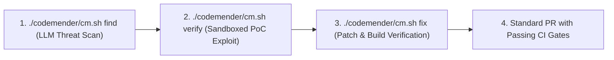

#### The 3-Step Remediation Workflow:
```bash
# 1. Scan codebase against threat context
./codemender/cm.sh find agents/starter_agent/app --quick --compact -c "$(cat codemender/context.txt)"

# 2. Prove vulnerability with a local Proof-of-Concept exploit in sandbox
./codemender/cm.sh verify <FINDING_ID> -c "Prove model argument bypass on BigQuery authorized view"

# 3. Generate surgical patch and verify all 99 unit tests pass
./codemender/cm.sh fix <FINDING_ID> -c "Minimal patch preserving behavior and adding unit test"
./codemender/cm.sh build
```
*Detailed operational runbook: [`docs/CODEMENDER_SECURITY_GUIDE.md`](docs/CODEMENDER_SECURITY_GUIDE.md).*

---

## 7. Terraform Infrastructure Ownership Matrix & Bootstrap Guide

The entire cloud infrastructure is declared in Terraform under [`deployment/terraform/single-project`](deployment/terraform/single-project).

### 7.1 Infrastructure Ownership Matrix (Terraform vs. CLI)

To avoid ownership collisions, responsibility is strictly separated between Terraform and the ADK CLI:

| Infrastructure Resource | Provisioning Owner | Lifecycle Mutation Owner | State Protection Policy |
| :--- | :--- | :--- | :--- |
| **Vertex AI Reasoning Engine** | Terraform (`agent_runtime.tf`) | `agents-cli deploy` (Code & Env) | `prevent_destroy = true`, `ignore_changes` on code |
| **BigQuery Dataset & Views** | Terraform (`bigquery.tf`) | Terraform / Release `--views-only` | `prevent_destroy = true` on dataset |
| **Secret Manager Secrets** | Terraform (`secrets.tf`) | Secret Manager CLI / Vault | `prevent_destroy = true` |
| **Cloud Run A2UI Frontend** | Terraform (`a2ui_iframe.tf` / `a2ui_iframe_lb.tf`) | `gcloud run deploy` (Image tags) | Ingress restricted to Load Balancer only |
| **WIF Pools & Service Accounts**| Terraform (`cicd_identity.tf`) | Terraform exclusively | Strict CEL attribute condition locking |
| **Monitoring SLOs & Alerts** | Terraform (`monitoring.tf`) | Terraform exclusively | Auto-closing alert strategies |

### 7.2 Step-by-Step Project Bootstrap

Initialize a fresh enterprise Google Cloud project using the automated bootstrap utility:

```bash
# 1. Run bootstrap script to create state bucket and initial plan
chmod +x ./deployment/bootstrap.sh
./deployment/bootstrap.sh \
  --project-id="your-gcp-project-id" \
  --repo-owner="your-github-org" \
  --repo-name="your-repo-name"

# 2. Configure GitHub repository secrets and branch protection
cd deployment/terraform/github
terraform init -backend-config="bucket=your-gcp-project-id-tfstate"
terraform apply -var-file=vars/env.tfvars
```

### 7.3 Production SRE Observability, 28-day SLOs & Alert Policies

The architecture establishes three observability layers:
- **Layer 1 (Telemetry Capture)**: Cloud Trace distributed span waterfalls with `NO_CONTENT` masking, raw audit logs stored in an immutable GCS bucket (30-day TTL), and deduplicated telemetry in BigQuery `telemetry_logs.completions_view`.
- **Layer 2 (Health & SLOs)**: 28-day rolling window Service Level Objectives:
  - *Availability SLO*: $\ge 99.5\%$ success rate.
  - *Latency SLO*: p95 latency $\le 8000\text{ ms}$.
  - *Multi-Burn-Rate Alerts*: Fast-burn (1-hour window, 14.4× burn rate) and slow-burn (6-hour window, 6× burn rate) policies.
- **Layer 3 (Incident Response)**: Alert policies link directly to actionable diagnostic steps in [`docs/RUNBOOK_ALERTS.md`](docs/RUNBOOK_ALERTS.md).

---

## 8. Repository Layout & Operational Runbook Index

### 8.1 Codebase Directory Structure

```text
.
├── .github/
│   ├── workflows/
│   │   ├── pr_checks.yaml              # 5 parallel PR status verification gates
│   │   ├── project_board_sync.yaml     # Real-time automated Kanban card state tracking
│   │   └── release.yaml                # Continuous delivery pipeline on merge to main
│   └── pull_request_template.md        # Standardized PR authoring template
├── agents/
│   └── starter_agent/                  # Archetype 1: Vertex AI Agent Engine ADK multi-agent system
│       ├── app/
│       │   ├── core/                   # Shared telemetry, guardrails, and connection factories
│       │   ├── pillars/                # Specialized domain reasoning pillars
│       │   ├── marketing_studio.py     # Creative campaign generator
│       │   ├── ontology.py             # Dataplex Business Glossary & Context Graph adapter
│       │   └── app_utils/              # Helper utilities
│       ├── agents-cli-manifest.yaml    # ADK deployment specification
│       ├── app.py                      # Application composition root
│       ├── deployment_metadata.json    # Live reasoning engine pointer metadata
│       └── Dockerfile
├── codemender/                         # Autonomous code-security remediation suite
│   ├── build.sh                        # Offline sandboxed verification runner
│   ├── cm.sh                           # CodeMender CLI wrapper pinned to gemini-2.5-pro
│   ├── config.yaml                     # Sandbox boundaries and scan exclusions
│   └── context.txt                     # System threat model context
├── data/
│   └── views/
│       └── 10_v_authorized_records.sql # BigQuery zero-trust authorized view with SESSION_USER()
├── deployment/
│   ├── bootstrap.sh                    # Automated project bootstrap utility
│   ├── ci/
│   │   ├── check_engine_consistency.py # Reasoning Engine triple-pointer validation
│   │   └── guard_terraform_plan.py     # Non-destructive Terraform plan inspector
│   ├── register_ge_oauth.py            # Gemini Enterprise OAuth registration script
│   └── terraform/
│       ├── github/                     # GitHub repository secrets and branch protection
│       └── single-project/             # GCP cloud infrastructure modules
├── docs/
│   ├── architecture/                   # High-res SVG and PNG architecture diagrams & builders
│   ├── BORDERLESS_LAKEHOUSE_GUIDE.md   # Unified cross-cloud Delta Lake & Iceberg lakehouse architecture
│   ├── CODEMENDER_SECURITY_GUIDE.md    # CodeMender threat modeling and remediation runbook
│   ├── DEMO_RUNBOOK.md                 # End-to-end verification and prompt demonstration guide
│   ├── GITOPS_WORKFLOW_GUIDE.md        # 1:1:1:1 GitOps operating model and WIF architecture
│   ├── MULTI_AGENT_DELIVERY_OPERATING_MODEL.md # Parallel swarm coordination and collision defense
│   ├── RUNBOOK_ALERTS.md               # SRE alert triage runbook with LQL and SQL diagnostics
│   └── TESTING_AND_EVAL_STANDARDS.md   # Testing pyramid, eval rubrics, and judge thresholds
├── finance-agent/                      # Archetype 2: Managed Off-the-Shelf Financial Agent
│   ├── personas/                       # Declarative persona specifications
│   └── skills/                         # Bring-Your-Own-Skills (BYOS) definitions
├── frontend/                           # Archetype 3: Interactive A2UI Canvas Frontend
│   ├── Dockerfile
│   ├── index.html                      # postMessage event listener & canvas UI
│   └── nginx.conf                      # Security headers & frame-ancestors CSP
├── gemini-spark-desktop/               # Archetype 4: Local Desktop Agent Extension
│   ├── scripts/                        # macOS Seatbelt profiles and verification scripts
│   └── skills/                         # Hosted MCP tool proxy adapters
├── prompts/
│   └── BOOTSTRAP_NEW_PROJECT_PROMPT.md # LLM instructions for scaffolding new agent services
├── skills/
│   └── gitops-devops-bootstrap/
│       └── SKILL.md                    # Standard operating procedure for blueprint deployment
├── tests/
│   ├── ci/preflight_bq_access.py       # BigQuery client connectivity validation
│   ├── eval/                           # LLM-as-a-Judge quality evaluation suite
│   │   ├── check_thresholds.py         # Summary renderer and threshold evaluator
│   │   ├── eval_config.yaml            # Quality, safety, and latency thresholds
│   │   └── response_quality.py         # Judge execution harness with model fallback
│   ├── integration/                    # End-to-end service integration tests
│   ├── load_test/                      # Concurrent Locust stress testing suite
│   └── unit/                           # Offline unit, AST, and guardrail test contracts
├── AGENTS.md                           # Operational law and binding rules for AI coding agents
├── CLAUDE.md                           # Architectural guidance for Claude assistants
├── GEMINI.md                           # Architectural guidance for Gemini assistants
├── LICENSE                             # Apache 2.0 Open Source License
├── NOTICE                              # Legal attribution notices
└── pyproject.toml                      # Unified Python build and tool configuration
```

### 8.2 Runbook & Standard Reference Index

| Document Title | File Path | Focus Area & Target Audience |
| :--- | :--- | :--- |
| **Demo Runbook** | [`docs/DEMO_RUNBOOK.md`](docs/DEMO_RUNBOOK.md) | Step-by-step verification commands, curl queries, and prompt packs for demonstrating all 4 archetypes. |
| **Borderless Lakehouse Guide** | [`docs/BORDERLESS_LAKEHOUSE_GUIDE.md`](docs/BORDERLESS_LAKEHOUSE_GUIDE.md) | Cross-cloud BigLake integration, Delta Lake and Iceberg table sharing, and Dataplex catalog synchronization. |
| **GitOps Workflow Guide** | [`docs/GITOPS_WORKFLOW_GUIDE.md`](docs/GITOPS_WORKFLOW_GUIDE.md) | 1:1:1:1 operating model, worktree isolation, keyless WIF authentication, and PR verification gates. |
| **CodeMender Security Guide** | [`docs/CODEMENDER_SECURITY_GUIDE.md`](docs/CODEMENDER_SECURITY_GUIDE.md) | Autonomous vulnerability scanning, sandboxed PoC exploit verification, and patch generation. |
| **Testing & Eval Standards** | [`docs/TESTING_AND_EVAL_STANDARDS.md`](docs/TESTING_AND_EVAL_STANDARDS.md) | Testing pyramid tiers, LLM judge rubrics, threshold calibration, and offline mock modes. |
| **Multi-Agent Operating Model** | [`docs/MULTI_AGENT_DELIVERY_OPERATING_MODEL.md`](docs/MULTI_AGENT_DELIVERY_OPERATING_MODEL.md) | Swarm coordination, file boundary ownership, collision prevention, and human review authority. |
| **SRE Alert Runbook** | [`docs/RUNBOOK_ALERTS.md`](docs/RUNBOOK_ALERTS.md) | Diagnostic workflows, LQL filters, and BigQuery SQL queries for triaging firing production alerts. |
| **Architecture Visual Assets** | [`docs/architecture/README.md`](docs/architecture/README.md) | Guide to regenerating SVG and 2× PNG architecture diagrams via Python and headless Chrome. |

---

### 8.3 License & Attribution

Copyright 2026 The Project Contributors.

Licensed under the Apache License, Version 2.0 (the "License");
you may not use this file except in compliance with the License.
You may obtain a copy of the License at

    https://www.apache.org/licenses/LICENSE-2.0

Unless required by applicable law or agreed to in writing, software
distributed under the License is distributed on an "AS IS" BASIS,
WITHOUT WARRANTIES OR CONDITIONS OF ANY KIND, either express or implied.
See the License for the specific language governing permissions and
limitations under the License.

Original and contributing authors are credited in [`CONTRIBUTORS.md`](CONTRIBUTORS.md).
