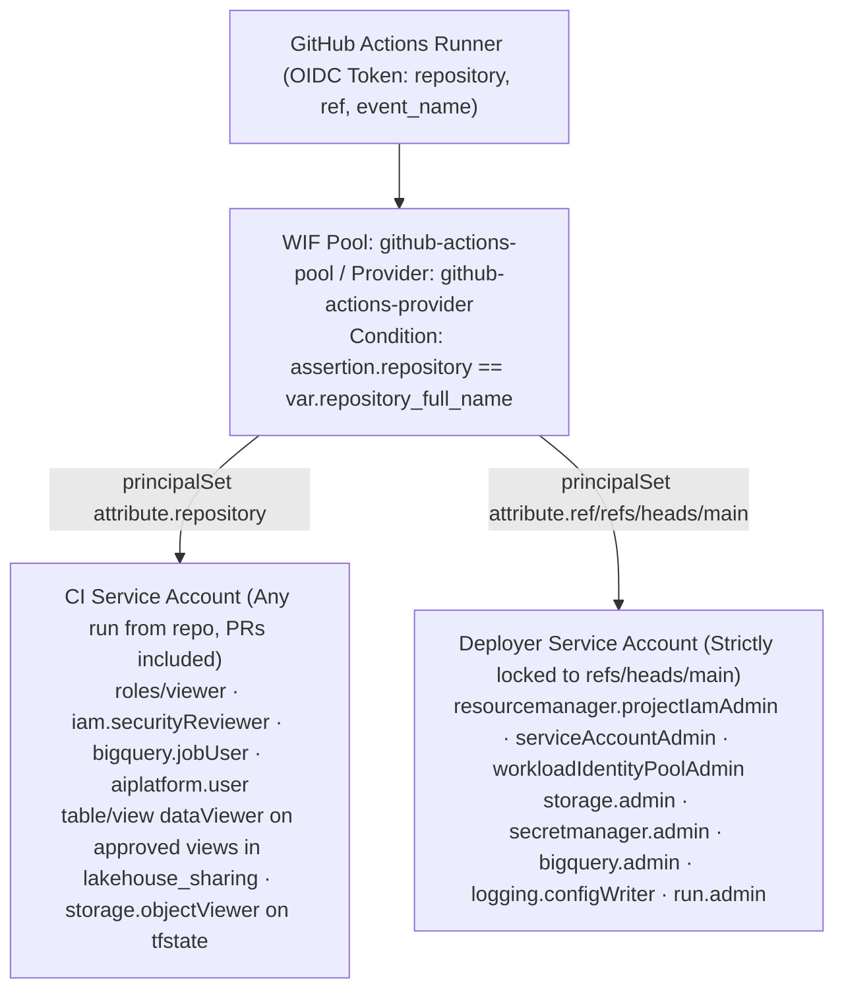
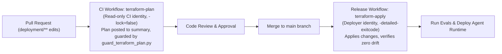

# Infrastructure as Code — GitOps Deployment Guide

This repository provisions and manages enterprise agent infrastructure across Google Cloud Platform and GitHub using Terraform and automated GitOps workflows.

The architecture provisions a single-environment Google Cloud foundation protected by automated CI/CD evaluation gates, least-privilege Workload Identity Federation, Dataplex Knowledge Catalog ontologies, and 4-tier row-level security (RLS) data governance.

The stack operates in two modes (`adopt_existing_resources` in `single-project/vars/env.tfvars`):
- **Mode A (Fresh Project, default)**: Terraform provisions all infrastructure elements (Vertex AI Agent Runtime, BigQuery datasets, Cloud Storage buckets, Dataplex Context Sets, Cloud Run A2UI front door, and external load balancing).
- **Mode B (Brownfield Adoption)**: Pre-existing runtime engines, secrets, and datasets are adopted via declarative Terraform 1.7+ `import {}` blocks without destructive teardowns or manual CLI state manipulation.

```text
deployment/
├── bootstrap.sh                 # One-time initialization: state bucket, first apply, entitlement seed, GitHub wiring
├── register_ge_oauth.py         # Registers Gemini Enterprise OAuth 2.0 authorization resource for per-user RLS
├── ci/
│   ├── guard_terraform_plan.py  # Gatekeeper refusing destructive plans unless TF_ALLOW_DESTROY=true
│   └── check_engine_consistency.py  # Ensures tfvars, deployment_metadata.json, and state name the same engine
├── data/
│   ├── seed_pilot_entitlements.sql  # Idempotent 4-tier RLS persona entitlement seed
│   └── views/*.sql              # 5 Authorized Views applied by sync_lakehouse_to_bq.py
└── terraform/
    ├── single-project/          # Google Cloud stack — CI plans on PRs, applies on main
    ├── github/                  # GitHub Actions wiring — applied by repo admin
    └── shared/                  # completions.sql, genai_logs_schema.json, dummy_source.b64
```

## Ownership Matrix

| Resource / Layer | Owner | Location |
|---|---|---|
| Agent Runtime **existence, identity type, IAM** | Terraform (created with placeholder container, or adopted) | `single-project/agent_runtime.tf`, `imports.tf` |
| Agent Runtime **code, image, env vars, secrets, scaling** | `agents-cli deploy`, run strictly by release pipeline | `.github/workflows/release.yaml` |
| API key secret container & accessor IAM | Terraform | `single-project/secrets.tf` |
| BigQuery `lakehouse_sharing` dataset & `user_entitlements` table schema | Terraform | `single-project/bigquery.tf` |
| Knowledge Catalog Context Set `EntryGroup` (`enterprise-context-set`), Aspect Types (`ontology-contract`, `governance-rls`), and Business Glossary (`enterprise-semantic-glossary`) | Terraform (`single-project/ontology_catalog.tf`); entries & aspects synced by `sync_knowledge_catalog_ontology.py` | `single-project/ontology_catalog.tf`, `sync_knowledge_catalog_ontology.py` |
| Hydrated tables & Authorized Views inside `lakehouse_sharing`, table row access policies | `sync_lakehouse_to_bq.py` + `deployment/data/views/*.sql` | repo root, `deployment/data/` |
| `user_entitlements` rows (4-Tier RLS metadata) | Data management workflows; CI identity row seeded by `bootstrap.sh` | `bootstrap.sh`, `deployment/data/seed_pilot_entitlements.sql` |
| CI identities, WIF pool/provider, role assignments | Terraform | `single-project/cicd_identity.tf` |
| Telemetry storage bucket, BigQuery telemetry dataset, log sinks, completions view | Terraform | `single-project/storage.tf`, `telemetry.tf` |
| `a2ui-iframe` Cloud Run service, load balancer, certificate, Cloud Armor, IAP access, DNS records | Terraform | `single-project/a2ui_iframe.tf`, `a2ui_iframe_lb.tf` |
| `a2ui-iframe` **image / revision** (frontend app) | `release.yaml` (Docker build → Artifact Registry → `gcloud run deploy`) | `.github/workflows/release.yaml`, `a2ui-iframe/` |
| Artifact Registry repository `a2ui-iframe` & deployer push access | Terraform | `single-project/a2ui_iframe.tf` |
| Terraform **state bucket** | `bootstrap.sh` (gcloud) — state bucket is kept external to prevent self-deletion | `bootstrap.sh` |
| GitHub secrets/variables, environments, branch protection | Terraform, applied by repo admin | `github/` |
| Gemini Enterprise registration | `agents-cli publish gemini-enterprise`, executed idempotently by release workflow | `release.yaml` |

The Vertex AI Agent Runtime split is encoded in `lifecycle.ignore_changes` on `google_vertex_ai_reasoning_engine.app`: Terraform never reverts what the release pipeline deploys, and `prevent_destroy = true` guarantees state safety.

## Identity Architecture



### Why Dual Identity Isolation Matters
GitHub Actions executes pull request workflow definitions directly from the submitting branch or fork.
With a single unified identity, any contributor who can open a PR could alter `.github/workflows/` to execute arbitrary Terraform mutations or exfiltrate credentials.
By binding Google Cloud Workload Identity Federation conditions directly to `assertion.ref == 'refs/heads/main'`, Google Cloud IAM enforces that PR runs can only assume the read-only CI identity (`ci_sa_id`). Only merges to `main` can assume the Deployer identity.

> [!WARNING]
> The Deployer identity holds elevated project administration roles necessary to manage IAM bindings. This is why `main` requires branch protection (`github/main.tf`) and why `guard_terraform_plan.py` prevents destructive operations by default.

## First-Time Setup (Bootstrap)

Because the Workload Identity Federation pool that allows GitHub Actions to authenticate is created by Terraform, the initial deployment bootstrap is run once by an administrator with Google Cloud credentials.

### Minimum Bootstrap IAM Roles

| Role | Purpose |
|---|---|
| `roles/resourcemanager.projectIamAdmin` | Project-level IAM bindings for CI identities, agent runtime, and end users |
| `roles/iam.workloadIdentityPoolAdmin` | Workload Identity Federation pool and GitHub OIDC provider |
| `roles/iam.serviceAccountAdmin` | CI, Deployer, and Runtime service accounts |
| `roles/storage.admin` | State bucket, logs bucket, artifacts bucket, and storage IAM |
| `roles/logging.configWriter` | Cloud Logging telemetry export sink |
| `roles/secretmanager.admin` | Secret Manager secrets and accessor bindings |
| `roles/serviceusage.apiKeysAdmin` | Maps/Places API key creation and restriction |
| `roles/bigquery.admin` | Telemetry dataset, lakehouse dataset, entitlements table, and authorized view bindings |
| `roles/serviceusage.serviceUsageAdmin` | Enabling Google Cloud APIs |
| `roles/aiplatform.user` or higher | Vertex AI Agent Runtime provisioning or adoption |
| `roles/run.admin`, `roles/compute.loadBalancerAdmin`, `roles/compute.securityAdmin`, `roles/certificatemanager.owner`, `roles/iap.admin` | A2UI Cloud Run service, serverless NEG, Cloud Armor, and HTTPS front door |
| `roles/dns.admin` | Cloud DNS records (if managing domain verification and A records) |

```bash
# Verify Google Cloud ADC credentials and GitHub CLI authentication
gcloud auth application-default login
gh auth login

# Run automated bootstrap
./deployment/bootstrap.sh \
  --project-id="your-gcp-project-id" \
  --repo-owner="your-github-org" \
  --repo-name="your-repo-name"
```

The bootstrap process performs the following sequence:
1. Enables required bootstrap APIs (`serviceusage`, `cloudresourcemanager`, `iam`, `sts`, `storage`).
2. Creates the GCS remote state bucket with Object Versioning enabled.
3. Initializes Terraform and applies `deployment/terraform/single-project/`.
4. Writes the generated Reasoning Engine ID back into `single-project/vars/env.tfvars` and `deployment_metadata.json`.
5. Seeds initial rows into the BigQuery `user_entitlements` table for the CI service account.
6. Invokes `deployment/terraform/github/` to wire secrets, variables, and branch protection rules into the GitHub repository.

### Mode A (Fresh Project) vs Mode B (Brownfield Adoption)

- **Fresh Project (`adopt_existing_resources = false`)**:
  Terraform creates all resources from scratch. The Agent Runtime is provisioned with a placeholder container, and the Secret Manager secret is initialized. After initial apply, bootstrap records the new engine ID in configuration files. Commit both files in your initialization PR.

- **Brownfield Adoption (`adopt_existing_resources = true`, `reasoning_engine_id = "<numeric-id>"`)**:
  Pre-existing resources (created via `agents-cli deploy` or cloud console) are adopted via `imports.tf`. The initial plan demonstrates imported state with zero destructive operations.

## A2UI Frontend Front Door (`a2ui-iframe`)

Gemini Enterprise renders custom agent user interfaces through the `WebFrameUrl` component. The component loads allowlisted HTTPS endpoints within an iframe rendered inside the end-user's browser.

Because requests originate from the end-user's browser rather than an internal VPC network, Cloud Run ingress cannot be purely private. Instead, an external HTTPS load balancer provides perimeter authentication and network filtering:

```text
End-User Browser (Gemini Enterprise WebFrameUrl iFrame)
  └─► https://a2ui.example.com                 Global External HTTPS Load Balancer (a2ui_iframe_lb.tf)
        ├─ Certificate Manager Certificate     DNS-authorized, auto-renewed TLS certificate
        ├─ Cloud Armor Security Policy         IP CIDR allowlist (a2ui_iframe_allowed_cidrs)
        ├─ Identity-Aware Proxy (IAP)          Google OAuth authentication (a2ui_iframe_iap_members)
        └─► Serverless Network Endpoint Group  Cloud Run a2ui-iframe service (Ingress: Internal LB Only)
```

### Authentication Modes (`a2ui_iframe_auth_mode`)

1. **Mode `"iap"` (Recommended Default)**:
   - Identity-Aware Proxy is enabled on the backend service.
   - Cloud Run enforces IAM checks (`invoker_iam_disabled = false`), allowing only IAP's service agent (`service-<project-number>@gcp-sa-iap.iam.gserviceaccount.com`).
   - Complies with enterprise organization policy `constraints/run.managed.requireInvokerIam`.
   - Users authenticate with Google Cloud Identity.
   - Note: Since Google's sign-in page cannot be embedded in third-party iframes, users must visit the top-level URL once to establish session cookies before loading inside Gemini Enterprise.

2. **Mode `"edge"`**:
   - Cloud Run invoker IAM check is disabled (`invoker_iam_disabled = true`).
   - Cloud Armor IP allowlisting serves as the primary perimeter gate.
   - Requires an organization policy constraint exception for `run.managed.requireInvokerIam` at the project level.

### Cloud Armor CIDR Filtering
Set `a2ui_iframe_allowed_cidrs` in `single-project/vars/env.tfvars` to your enterprise corporate office and VPN egress IP ranges. When this list is populated, Cloud Armor evaluates rules in prioritized chunks and applies a default `deny(403)` policy to all other IP addresses.

## Data Hydration & Governance

Terraform establishes the BigQuery datasets and table schemas, while data synchronization pipelines hydrate tables and apply 4-tier row-level security (RLS).

Run the hydration pipeline from the project root using `uv`:

```bash
# Sync from Lakehouse source or Delta Sharing endpoint
uv run python sync_lakehouse_to_bq.py

# Clone an existing environment in the same region
uv run python sync_lakehouse_to_bq.py --from-bigquery source-project-id

# Reconcile views and Authorized View permissions only
uv run python sync_lakehouse_to_bq.py --views-only
```

### 4-Tier Row-Level Security Contract
The BigQuery operations table enforces row access policies dynamically based on `SESSION_USER()` mapping into `user_entitlements`:

1. **`BRANCH_STAFF`**: Scoped strictly to matching `branch_id` and `username`.
2. **`BRANCH_MANAGER`**: Scoped to all transactions within their assigned `branch_id`.
3. **`REGIONAL_MANAGER`**: Scoped to all branches within their `region_group`.
4. **`DIVISIONAL_HEAD`**: Unrestricted access across the division or enterprise (`division = 'ALL'`).

### Authorized Views Isolation
To maintain strict PII compliance, five Authorized Views are maintained under `deployment/data/views/`:
- `10_v_operations.sql`: Operational activity filtered by 4-tier RLS policy.
- `20_v_catalog_enriched.sql`: Enriched product catalog with zero raw customer identifiers.
- `30_v_finance_transactions.sql`: Financial ledger transactions.
- `40_v_finance_receipts.sql`: Normalized line items and tax adjustments.
- `50_v_finance_customer_bridge.sql`: Pseudonymized customer bridge using SHA-256 hashing (`TO_HEX(SHA256(CAST(customer_id AS STRING)))`), completely stripping raw PII.

Calling agents and analysts are granted `roles/bigquery.dataViewer` strictly at the view level, preventing direct table queries against raw datasets or entitlement definitions.

## Day-2 Operations & GitOps Workflows



### Automated Drift Correction
Every push to `main` executes `terraform plan`. If infrastructure drift has occurred (e.g., manual console edits or policy changes), Terraform reconciles state prior to running test suites and deploying new agent revisions.

### Safety Guards (`guard_terraform_plan.py`)
Pull request plans that attempt to delete or replace infrastructure components fail automatically in CI. If a destructive migration is required:
1. Temporarily set the repository variable `TF_ALLOW_DESTROY = "true"` in GitHub Actions.
2. Execute the authorized release workflow.
3. Reset `TF_ALLOW_DESTROY = "false"`.

Safe IAM policy tightenings (such as revoking deprecated user roles on Authorized Views) are detected by `guard_terraform_plan.py` and permitted without blocking the pipeline.

### Engine Consistency Verification (`ci/check_engine_consistency.py`)
To prevent duplicate reasoning engines from being created accidentally during deployments, CI validates that:
- `single-project/vars/env.tfvars` (`reasoning_engine_id`)
- `deployment_metadata.json` (`remote_agent_runtime_id`)
- Terraform state (`google_vertex_ai_reasoning_engine.app.id`)
all reference the identical Vertex AI resource identifier.

## Known Architecture Decisions

1. **Entitlement Seeds Managed Outside Terraform**:
   User entitlements contain business data rather than infrastructure topology. Entitlements are seeded via idempotent SQL (`deployment/data/seed_pilot_entitlements.sql`) and verified during preflight checks.

2. **GitHub Stack Applied Separately by Admins**:
   The default GitHub workflow `GITHUB_TOKEN` lacks permissions to manage branch protection rules, environment secrets, and repository variables. The `github/` Terraform stack is applied during bootstrap and administrative updates.

3. **Public Load Balancer with Perimeter Defense**:
   Because browser-based iframes in Gemini Enterprise require internet-routable HTTPS endpoints, the A2UI service is exposed via an external HTTPS load balancer protected by Cloud Armor CIDR allowlists and Identity-Aware Proxy.

4. **Zero-Downtime IAM Migrations**:
   When transitioning user cohorts between roles or datasets, Terraform `moved {}` blocks are used to transfer state references, preventing transient access loss during plan execution.

## Troubleshooting Runbook

| Symptom | Root Cause | Remediation |
|---|---|---|
| `terraform init` fails with bucket not found | State bucket has not been created or project ID is misconfigured. | Verify `project_id` and execute `./deployment/bootstrap.sh`. |
| PR `terraform-plan` fails with `403 storage.objects.get` | CI service account lacks read permissions on GCS state bucket. | Verify `roles/storage.objectViewer` is granted on state bucket. |
| PR `terraform-plan` fails with `403 *.getIamPolicy` | CI service account lacks security reviewer privileges. | Ensure `roles/iam.securityReviewer` is present in `ci_project_roles`. |
| `Error 409: already exists` during resource apply | Resource pre-dates Terraform management. | Add declarative `import {}` block in `imports.tf` matching exact resource ID. |
| Destroy guard blocks plan execution | Plan proposes resource deletion or replacement. | Inspect plan diff. If intentional, toggle `TF_ALLOW_DESTROY=true` in GitHub repo settings. |
| Evaluation tests return 0 rows from BigQuery views | CI service account missing from `user_entitlements` table or dataset not hydrated. | Run `sync_lakehouse_to_bq.py` and seed CI service account email into `user_entitlements`. |
| `check_engine_consistency.py` fails with mismatched IDs | A secondary engine was created or configuration files were not updated. | Point `env.tfvars` and `deployment_metadata.json` to authoritative engine ID and commit. |
| A2UI frontend iframe displays blank page | Browser blocking third-party cookies or user has not completed initial IAP sign-in. | Visit top-level A2UI domain once in a new browser tab or configure auth mode `edge`. |
| Certificate Manager certificate stuck in `PROVISIONING` | DNS authorization CNAME or A records not resolving. | Verify Cloud DNS records or external DNS zone delegation for `a2ui_iframe_domain`. |
