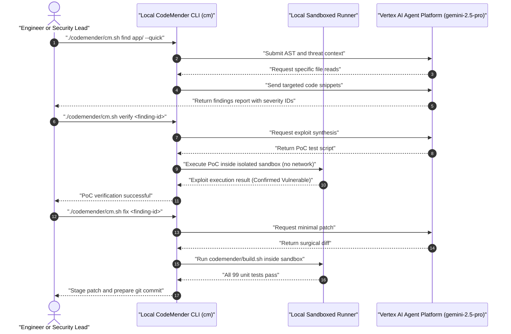

<!--
Copyright 2026 The Project Contributors

Licensed under the Apache License, Version 2.0 (the "License");
you may not use this file except in compliance with the License.
You may obtain a copy of the License at

    https://www.apache.org/licenses/LICENSE-2.0

Unless required by applicable law or agreed to in writing, software
distributed under the License is distributed on an "AS IS" BASIS,
WITHOUT WARRANTIES OR CONDITIONS OF ANY KIND, either express or implied.
See the License for the specific language governing permissions and
limitations under the License.
-->

# CodeMender Security Guide — Autonomous Vulnerability Discovery & Local Sandbox Repair

This guide details the operation, configuration, and security sandbox architecture of **CodeMender**, the Google DeepMind automated vulnerability discovery and remediation agent integrated into the blueprint.

---

## Table of Contents

- [1. Architectural Overview & Separation of Concerns](#1-architectural-overview--separation-of-concerns)
- [2. Threat Model Context & Protected Paths](#2-threat-model-context--protected-paths)
- [3. The 3-Step Remediation Loop (`find` -> `verify` -> `fix`)](#3-the-3-step-remediation-loop-find---verify---fix)
- [4. Local Sandbox Isolation Policy](#4-local-sandbox-isolation-policy)
- [5. CLI Wrapper & Model Configuration](#5-cli-wrapper--model-configuration)
- [6. Patch Lifecycle & Pull Request Gate Integration](#6-patch-lifecycle--pull-request-gate-integration)

---

## 1. Architectural Overview & Separation of Concerns

CodeMender decouples reasoning from code execution:
- **Remote Reasoning Engine**: Deep reasoning runs inside Google Cloud on the Gemini Enterprise Agent Platform using `gemini-2.5-pro`. The cloud backend analyzes AST structures, synthesizes exploits, and authors surgical patches.
- **Local Client Sandbox (`cm` CLI)**: File access, syntax parsing, build verification, and Proof-of-Concept (PoC) exploit execution occur exclusively inside an isolated, unprivileged local sandbox on the developer's workstation.
- **Zero Raw Data Ingestion**: The remote model only receives target code snippets and build outputs requested via tool calls; full source archives are never exfiltrated.



---

## 2. Threat Model Context & Protected Paths

CodeMender evaluates findings against an explicit threat model defined in [`codemender/context.txt`](../codemender/context.txt).

### 2.1 Primary Threat Vectors

1. **SQL & BQ Query Manipulation**: Ensuring model-generated arguments passed to BigQuery cannot escape Authorized View boundaries or tamper with `SESSION_USER()` predicates.
2. **PII and Sensitive Compensation Leakage**: Verifying that regex and tool guardrails intercept attempts to extract restricted columns.
3. **Frontend Origin Spoofing**: Auditing postMessage event listeners in `frontend/index.html` to guarantee strict origin verification.
4. **IAM Privilege Escalation**: Inspecting Terraform configurations for over-broad IAM roles or unprotected pipeline identities.

### 2.2 Protected Files (`codemender/config.yaml`)

Certain critical governance files cannot be modified by automated repair passes:
- `deployment/ci/guard_terraform_plan.py`
- `deployment/ci/check_engine_consistency.py`
- `codemender/config.yaml`
- `.github/workflows/*.yaml`

---

## 3. The 3-Step Remediation Loop (`find` -> `verify` -> `fix`)

### Step 1: Discover Vulnerabilities (`cm find`)

Scan the repository or a specific subsystem against the threat model:

```bash
# Execute rapid scan on core application logic
./codemender/cm.sh find agents/starter_agent/app --quick --compact -c "$(cat codemender/context.txt)"

# View structured findings summary table
./codemender/cm.sh report --format=md
```

### Step 2: Prove Vulnerabilities in the Sandbox (`cm verify`)

Verify whether a finding is a genuine exploit by executing a sandboxed Proof-of-Concept:

```bash
# Generate and run sandboxed exploit
./codemender/cm.sh verify <FINDING_ID> -c "Prove whether a model-controlled argument can access unauthorized BigQuery tables."
```

### Step 3: Apply & Verify Surgical Patches (`cm fix`)

Instruct CodeMender to generate a patch and assert that all unit tests pass:

```bash
# Create dedicated security fix branch
git switch -c codemender/fix-<FINDING_ID>

# Apply fix and run automated build verification
./codemender/cm.sh fix <FINDING_ID> -c "Smallest change that removes the vulnerability while preserving functionality."

# Validate build loop
./codemender/cm.sh build
```

---

## 4. Local Sandbox Isolation Policy

To prevent rogue exploit scripts from impacting developer workstations, `codemender/build.sh` runs with strict boundary enforcement:

- **Network Access Disabled**: Proof-of-concept exploits run without internet or LAN access.
- **Restricted Filesystem**: Sandbox write operations are restricted to temporary scratch directories.
- **Execution Timeouts**: All verification runs enforce a strict 60-second execution deadline.
- **Fail-Closed Cleanups**: `cm fix` and `cm vcs reset` clean untracked files automatically (`git clean -fd`).

---

## 5. CLI Wrapper & Model Configuration

The blueprint provides [`codemender/cm.sh`](../codemender/cm.sh) to standardize execution flags and model selection across teams:

```bash
#!/usr/bin/env bash
set -euo pipefail

# Force dedicated configuration directory
export CM_HOME="$(cd "$(dirname "${BASH_SOURCE[0]}")" && pwd)"

# Pin high-reasoning Gemini model
exec cm --model="gemini-2.5-pro" "$@"
```

### 5.1 Preflight Health Check

Verify CLI installation, cloud credentials, and API reachability:

```bash
./codemender/cm.sh health --strict
./codemender/cm.sh init --verify
./codemender/cm.sh build
```

---

## 6. Patch Lifecycle & Pull Request Gate Integration

CodeMender is operated on demand by engineers; it is deliberately **not** embedded as a blocking stage in continuous integration. This ensures developers maintain full agency over vulnerability triage.

Once a fix is verified locally:
1. Inspect the patch diff: `./codemender/cm.sh vcs diff`
2. Stage the modified files: `./codemender/cm.sh vcs stage`
3. Commit and push:
   ```bash
   git commit -m "security: remediate BigQuery parameter boundary (CodeMender #<FINDING_ID>)"
   git push -u origin HEAD
   gh pr create --fill
   ```
4. The resulting PR must satisfy all standard CI gates (`lint`, `terraform-plan`, `tests`, `evals`, `frontend-build`) before merging to `main`.
