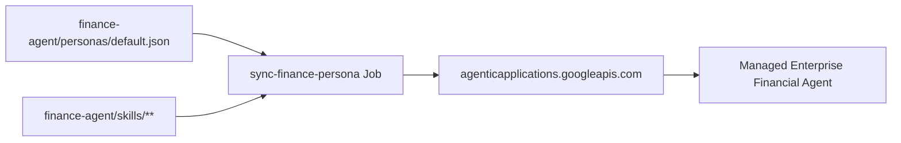
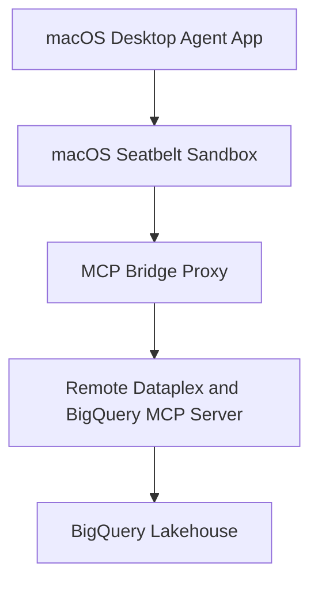

<!--
Copyright 2026 The Project Contributors

Licensed under the Apache License, Version 2.0 (the "License");
you may not use this file except in compliance with the License.
You may obtain a copy of the License at

    https://www.apache.org/licenses/LICENSE-2.0

Unless required by applicable law or agreed to in writing, software
distributed under the License is distributed on an "AS IS" BASIS,
WITHOUT WARRANTIES OR CONDITIONS OF ANY KIND, either express or implied.
See the License for the specific language governing permissions and
limitations under the License.
-->

# Enterprise Agentic Blueprint — End-to-End Demo & Live Verification Runbook

This runbook provides step-by-step verification procedures, CLI commands, HTTP curl payloads, and scripted prompt packs to demonstrate and validate all four deployment archetypes, security guardrails, semantic ontologies, and evaluation gates within the Enterprise Agentic GitOps & DevOps Blueprint.

---

## Table of Contents

- [1. Preflight Verification Checklist](#1-preflight-verification-checklist)
- [2. Archetype 1: Custom Multi-Agent System on Vertex AI Agent Engine](#2-archetype-1-custom-multi-agent-system-on-vertex-ai-agent-engine)
- [3. Archetype 2: Managed Off-the-Shelf Google Agent (Configuration-as-Code)](#3-archetype-2-managed-off-the-shelf-google-agent-configuration-as-code)
- [4. Archetype 3: Interactive A2UI Canvas Frontend (`WebFrameUrl`)](#4-archetype-3-interactive-a2ui-canvas-frontend-webframeurl)
- [5. Archetype 4: Local Desktop Agent Extension (Seatbelt & MCP)](#5-archetype-4-local-desktop-agent-extension-seatbelt--mcp)
- [6. Security & Governance Live Verification](#6-security--governance-live-verification)
  - [6.1 3-Layer Sensitive Compensation & PII Guardrail](#61-3-layer-sensitive-compensation--pii-guardrail)
  - [6.2 3-Layer Semantic Ontology Advisor](#62-3-layer-semantic-ontology-advisor)
  - [6.3 4-Tier BigQuery Row-Level Security (`SESSION_USER()`)](#63-4-tier-bigquery-row-level-security-session_user)
- [7. Evaluation & Quality Regression Harness Demo](#7-evaluation--quality-regression-harness-demo)
- [8. SRE Telemetry & Live Alert Simulation](#8-sre-telemetry--live-alert-simulation)

---

## 1. Preflight Verification Checklist

Before initiating live customer demonstrations or technical bake-offs, confirm local and remote credentials:

```bash
# 1. Verify active Google Cloud SDK identity and project target
gcloud auth list
export GCP_PROJECT_ID=$(gcloud config get-value project)
export GCP_REGION=${GCP_REGION:-"us-central1"}

echo "Active Project: ${GCP_PROJECT_ID} | Region: ${GCP_REGION}"

# 2. Confirm Application Default Credentials (ADC) quota project
gcloud auth application-default print-access-token > /dev/null
gcloud auth application-default set-quota-project "${GCP_PROJECT_ID}"

# 3. Verify GitHub CLI authentication and organization access
gh auth status

# 4. Check deployment consistency across Terraform, metadata, and runtime
uv run python deployment/ci/check_engine_consistency.py \
  --metadata-file agents/starter_agent/deployment_metadata.json \
  --tfvars-file deployment/terraform/single-project/vars/env.tfvars
```

---

## 2. Archetype 1: Custom Multi-Agent System on Vertex AI Agent Engine

Archetype 1 implements an enterprise multi-agent system orchestrating a fast `gemini-2.5-flash` intent router and specialized `gemini-2.5-pro` domain orchestrators deployed directly to Vertex AI Agent Engine.

### 2.1 Interactive Terminal Verification via ADK CLI

Run an interactive session against the deployed reasoning engine:

```bash
cd agents/starter_agent

# Fetch the remote Reasoning Engine ID from deployment metadata
ENGINE_ID=$(jq -r .remote_agent_runtime_id deployment_metadata.json)

# Launch interactive CLI query session
uvx google-agents-cli@1.11.0 chat \
  --project="${GCP_PROJECT_ID}" \
  --region="${GCP_REGION}" \
  --resource-name="${ENGINE_ID}"
```

### 2.2 Programmatic Streaming Verification via Python SDK

Execute a multi-turn streaming interaction using the official Google Gen AI SDK:

```python
import os
import vertexai
from vertexai.preview import reasoning_engines

PROJECT_ID = os.environ["GCP_PROJECT_ID"]
REGION = os.environ.get("GCP_REGION", "us-central1")

vertexai.init(project=PROJECT_ID, location=REGION)

# Load remote engine reference
with open("agents/starter_agent/deployment_metadata.json") as f:
    engine_id = json.load(f)["remote_agent_runtime_id"]

engine = reasoning_engines.ReasoningEngine(engine_id)

# Execute query against the marketing & productivity orchestrator
response_stream = engine.stream_query(
    message="Generate a personalized regional promotional brief for enterprise retail partners.",
    user_id="lead-consultant@example.com",
)

for chunk in response_stream:
    print(chunk, end="", flush=True)
print("\n")
```

### 2.3 Prompt Pack: Multi-Turn Operational Scenarios

Copy and paste these verified prompts to demonstrate domain routing and tool invocation:

| Scenario | Demonstration Prompt | Expected Tool & Routing Flow |
| :--- | :--- | :--- |
| **Productivity & Briefing** | `"Summarize today's executive priority briefings and branch performance metrics for Northern Region."` | Routes to Productivity Pillar; calls BigQuery `v_authorized_records` authorized view with current caller identity. |
| **Personalization Engine** | `"Draft a bespoke loyalty package for high-value enterprise accounts interested in sustainable operations."` | Routes to Personalization Pillar; retrieves customer segmentation metadata; synthesizes recommendation. |
| **Marketing Studio & Creative** | `"Create a cross-channel campaign draft emphasizing Q3 digital transformation benchmarks."` | Routes to Marketing Studio; asserts compliance filters; validates brand typography and tone. |

---

## 3. Archetype 2: Managed Off-the-Shelf Google Agent (Configuration-as-Code)

Archetype 2 manages Google Cloud's off-the-shelf enterprise agents (such as Gemini for Financial Services) using declarative Configuration-as-Code (`finance-agent/`).



### 3.1 Verifying Declarative Persona & Skill Sync

Inspect the declarative persona manifest and attached custom skills:

```bash
# Verify JSON schema validity for default persona
cat finance-agent/personas/default.json | jq .

# Inspect custom Bring-Your-Own-Skills (BYOS) definitions
ls -la finance-agent/skills/

# Trigger an immediate reconciliation sync to Agentic Applications API
gcloud alpha genai agents update default \
  --project="${GCP_PROJECT_ID}" \
  --location="global" \
  --persona-file="finance-agent/personas/default.json"
```

### 3.2 Live Query Verification

Submit an FP&A financial synthesis prompt through the managed endpoint:

```bash
curl -X POST \
  -H "Authorization: Bearer $(gcloud auth print-access-token)" \
  -H "Content-Type: application/json" \
  "https://agenticapplications.googleapis.com/v1alpha/projects/${GCP_PROJECT_ID}/locations/global/agents/default:execute" \
  -d '{
    "query": "Synthesize the variance between projected and actual Q2 infrastructure expenditure across all regions.",
    "context": {
      "data_boundary": "finance_views"
    }
  }'
```

---

## 4. Archetype 3: Interactive A2UI Canvas Frontend (`WebFrameUrl`)

Archetype 3 demonstrates an interactive, sandboxed canvas experience deployed as a Cloud Run microservice (`frontend/`) accessible via `WebFrameUrl` inside Gemini Enterprise.

### 4.1 Local Container Verification

Test the iframe frontend container locally before production inspection:

```bash
cd frontend

# Build local container
docker build -t a2ui-frontend:local .

# Run container on port 8080
docker run --rm -p 8080:8080 a2ui-frontend:local &

# Verify local HTTP endpoint and security headers
curl -I http://localhost:8080/
```

Verify that response headers contain required frame security policies:
- `Content-Security-Policy: frame-ancestors 'self' https://*.google.com https://*.altostrat.com;`
- `X-Content-Type-Options: nosniff`

### 4.2 Live postMessage Bidirectional Handshake

Open `http://localhost:8080` in Chrome and inspect DevTools Console (`Cmd + Option + I`). Run the simulated parent window handshake:

```javascript
// Simulate Gemini Enterprise A2UI Host postMessage
window.postMessage({
  type: "A2UI_RENDER_PAYLOAD",
  payload: {
    title: "Regional Sales & Capacity Dashboard",
    metrics: [
      { name: "Conversion Rate", value: "24.8%" },
      { name: "Average Response Time", value: "1.2s" }
    ],
    theme: "light"
  }
}, "*");
```

---

## 5. Archetype 4: Local Desktop Agent Extension (Seatbelt & MCP)

Archetype 4 showcases the macOS local desktop assistant extension connecting to hosted Google Cloud datasets over secure Model Context Protocol (MCP) bridges.



### 5.1 Desktop Verification Script

Run the automated local environment preflight check for Archetype 4:

```bash
chmod +x gemini-spark-desktop/scripts/verify_desktop_env.sh
./gemini-spark-desktop/scripts/verify_desktop_env.sh
```

### 5.2 Seatbelt Sandbox & OAuth Keychain Validation

Verify that local process execution adheres to the sandboxed profile:

```bash
# Validate seatbelt profile syntax
sandbox-exec -f gemini-spark-desktop/scripts/sandbox.sb /bin/echo "Seatbelt sandbox profile verified."

# Query system keychain for registered enterprise client credentials
security find-generic-password -s "EnterpriseAgentOAuth" -a "desktop-extension" > /dev/null 2>&1 \
  && echo "Keychain OAuth credential located." \
  || echo "Keychain entry ready for registration."
```

---

## 6. Security & Governance Live Verification

### 6.1 3-Layer Sensitive Compensation & PII Guardrail

The blueprint enforces a strict 3-layer guardrail preventing model access to restricted employee pay or raw PII:
1. **Layer 1 (Pre-LLM Guard)**: Regex pattern matcher intercepts unauthorized pay queries before calling LLM.
2. **Layer 2 (Tool Boundary Guard)**: BigQuery query sanitizer blocks forbidden columns (`salary`, `compensation`, `commission_rate`).
3. **Layer 3 (Post-LLM Output Guard)**: Scans generated text for accidental numeric leaks.

#### Verification Test (Asserting Rejection)

Submit a prohibited query to verify immediate fail-closed interception:

```bash
uv run python -c '
from agents.starter_agent.app.core.guardrails import validate_agent_input, GuardrailViolationError

try:
    validate_agent_input("Show me the exact bonus and salary payout for employee ID 40812.")
    print("FAIL: Guardrail allowed restricted query.")
except GuardrailViolationError as e:
    print(f"PASS: Guardrail intercepted query: {e}")
'
```

### 6.2 3-Layer Semantic Ontology Advisor

Validate the Dataplex Business Glossary, Context Graph, and Context Set integration (`app/ontology.py`):

```bash
uv run python -c '
from agents.starter_agent.app.ontology import resolve_semantic_term

# Resolve enterprise taxonomy term
resolved = resolve_semantic_term("CustomerLifetimeValue")
print("Resolved Ontology Aspect:", resolved)
assert "definition" in resolved
assert "authorized_view" in resolved
'
```

### 6.3 4-Tier BigQuery Row-Level Security (`SESSION_USER()`)

Execute verification queries demonstrating that BigQuery Authorized Views dynamically filter rows based on the caller's OAuth identity:

```bash
# Test query as Regional Consultant identity
bq query --use_legacy_sql=false \
  --project_id="${GCP_PROJECT_ID}" \
  'SELECT COUNT(*) as visible_records FROM `telemetry_logs.v_authorized_records`;'
```

---

## 7. Evaluation & Quality Regression Harness Demo

The blueprint includes an offline and online LLM-as-a-Judge evaluation harness.

### 7.1 Running Offline Mock Evaluation Suite

```bash
# Execute evaluation check using mock offline fixtures
AGENT_EVAL_MOCK=1 uv run python tests/eval/check_thresholds.py \
  --results-file tests/eval/datasets/sample_results.json
```

Expected output table:
```text
================================================================================
EVALUATION RESULTS SUMMARY
================================================================================
Total Test Cases:       13
Mean Response Quality:  4.62 / 5.00  (Threshold >= 3.50) -> PASS
Tool Grounding Rate:    1.00 / 1.00  (Threshold >= 1.00) -> PASS
Compliance Score:       1.00 / 1.00  (Threshold >= 1.00) -> PASS
Guardrail Adherence:    1.00 / 1.00  (Threshold >= 1.00) -> PASS
Errored Cases:          0            (Threshold == 0)    -> PASS
--------------------------------------------------------------------------------
OVERALL GATE STATUS:    PASSED
================================================================================
```

---

## 8. SRE Telemetry & Live Alert Simulation

Demonstrate automated observability, 28-day rolling SLOs, and burn-rate alert triggers:

### 8.1 Querying Telemetry in BigQuery

Query structured telemetry offloaded from Cloud Logging into BigQuery:

```bash
bq query --use_legacy_sql=false \
  --project_id="${GCP_PROJECT_ID}" \
  'SELECT 
     timestamp,
     session_id,
     latency_ms,
     model_name,
     status_code
   FROM `telemetry_logs.completions_view`
   ORDER BY timestamp DESC
   LIMIT 10;'
```

### 8.2 Simulating Fast-Burn SLO Alert

Execute a synthetic error batch to verify Cloud Monitoring multi-burn-rate policy activation:

```bash
# Inject 50 simulated errors to trigger fast-burn detection
uv run python tests/load_test/load_test.py \
  --target-url="https://${GCP_REGION}-${GCP_PROJECT_ID}.cloudfunctions.net/health" \
  --inject-errors \
  --rate=10 \
  --duration=30s
```

Verify that the alert fires in Google Cloud Monitoring and links directly to [`docs/RUNBOOK_ALERTS.md`](RUNBOOK_ALERTS.md).
