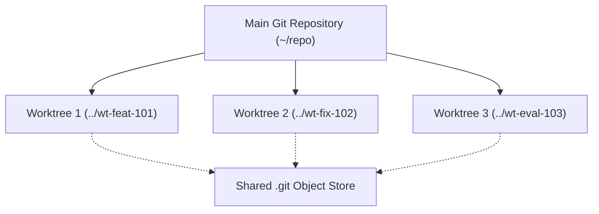
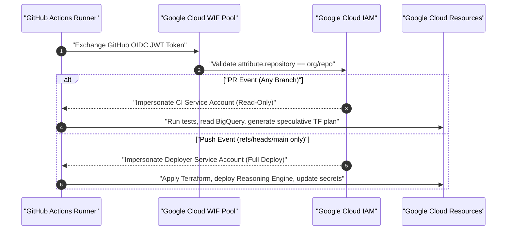
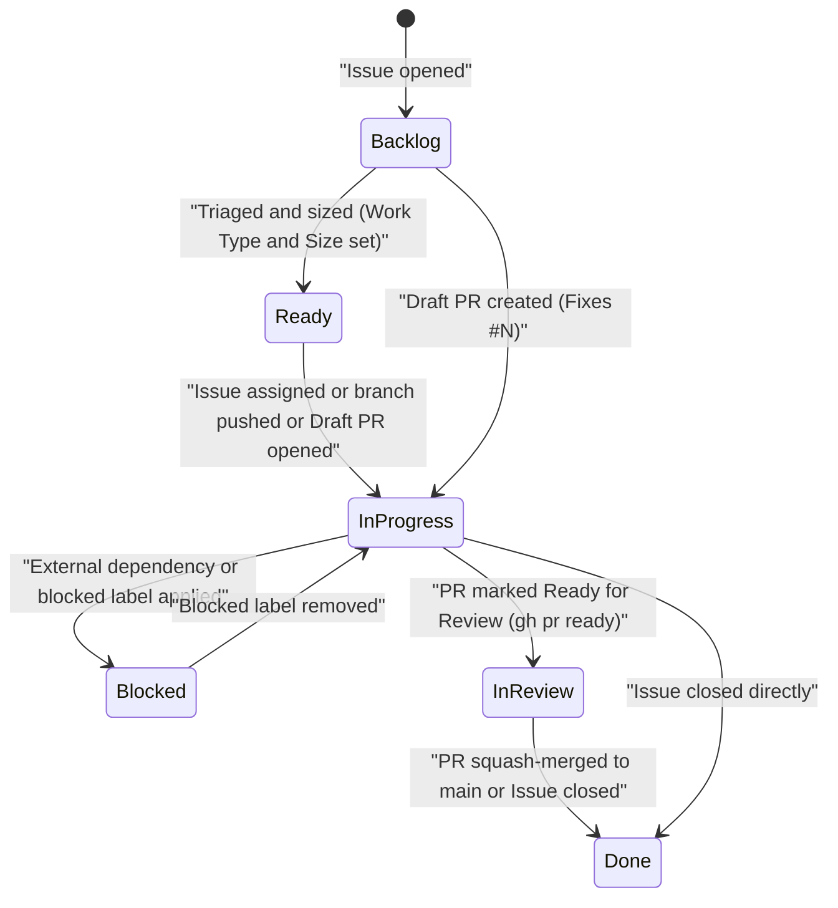
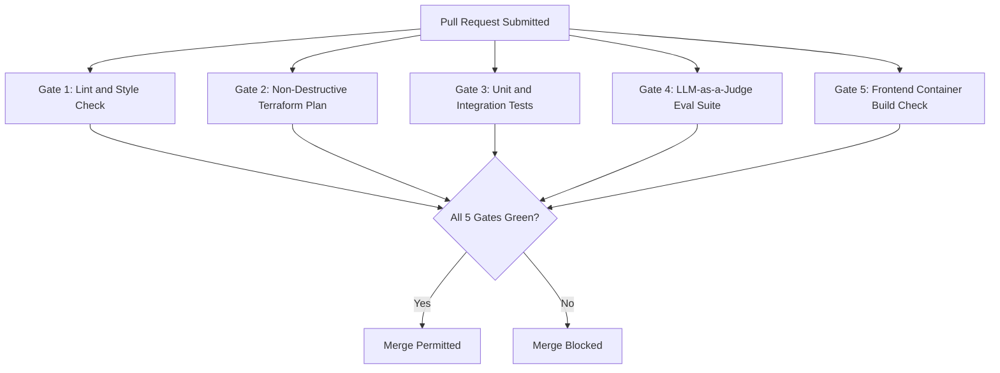

<!--
Copyright 2026 The Project Contributors

Licensed under the Apache License, Version 2.0 (the "License");
you may not use this file except in compliance with the License.
You may obtain a copy of the License at

    https://www.apache.org/licenses/LICENSE-2.0

Unless required by applicable law or agreed to in writing, software
distributed under the License is distributed on an "AS IS" BASIS,
WITHOUT WARRANTIES OR CONDITIONS OF ANY KIND, either express or implied.
See the License for the specific language governing permissions and
limitations under the License.
-->

# Multi-Agent GitOps Workflow Guide — 1:1:1:1 Operating Model & Keyless CI/CD

This guide defines the multi-agent developer workflow, branching hygiene, Workload Identity Federation (WIF) security architecture, and automated release gates governing the Enterprise Agentic GitOps & DevOps Blueprint.

---

## Table of Contents

- [1. The 1:1:1:1 Operating Principle](#1-the-1111-operating-principle)
- [2. Isolated `git worktree` Management](#2-isolated-git-worktree-management)
- [3. Keyless Workload Identity Federation (WIF) Architecture](#3-keyless-workload-identity-federation-wif-architecture)
- [4. Automated Kanban Board Synchronization](#4-automated-kanban-board-synchronization)
- [5. The 5 Mandatory Pull Request Verification Gates](#5-the-5-mandatory-pull-request-verification-gates)
- [6. Continuous Delivery & Engine Triple-Pointer Sync](#6-continuous-delivery--engine-triple-pointer-sync)
- [7. Branch Cleanup & Post-Merge Hygiene](#7-branch-cleanup--post-merge-hygiene)

---

## 1. The 1:1:1:1 Operating Principle

To allow human software engineers and autonomous AI coding agents to collaborate concurrently without merge collisions or lost work, every unit of work must obey the **`1:1:1:1` Single-Scope Rule**:

$$\text{1 Atomic Scope} \Longleftrightarrow \text{1 GitHub Issue} \Longleftrightarrow \text{1 Kanban Card} \Longleftrightarrow \text{1 Git Worktree} \Longleftrightarrow \text{1 Pull Request}$$

- **No Multi-Scope PRs**: Never bundle a database migration, agent prompt tweak, and frontend layout change in a single PR. Decompose broad initiatives into atomic issues.
- **Traceability**: Every Pull Request title must state its scope clearly, and the PR body must contain `Fixes #<ISSUE_NUMBER>` so GitHub automatically links the card and closes the issue upon squash merge.
- **Optimistic Concurrency**: Because services are modularized (`agents/starter_agent/`, `finance-agent/`, `frontend/`, `deployment/terraform/`), parallel PRs merge safely without repo-wide code freezes.

---

## 2. Isolated `git worktree` Management

Engineers and subagents must work inside isolated `git worktree` directories rather than switching branches in place. This guarantees that uncommitted changes, scratch logs, and active test runs in one branch are never clobbered by another branch checkout.



### 2.1 Worktree Setup Workflow

```bash
# 1. Ensure master tracking branch is up to date
git fetch origin main

# 2. Add an isolated worktree for Issue #101
git worktree add ../agent-wt-101 -b feat/101-semantic-ontology origin/main

# 3. Enter the isolated worktree
cd ../agent-wt-101

# 4. Copy local environment variables if needed
cp -n ../repo/.env .env 2>/dev/null || true

# 5. Open an early Draft PR to register presence on the Kanban board
git commit --allow-empty -m "chore: start #101 semantic ontology improvements"
git push -u origin feat/101-semantic-ontology
gh pr create --draft --title "[P1] Enhance semantic ontology adapter" --body "Fixes #101"
```

---

## 3. Keyless Workload Identity Federation (WIF) Architecture

Static service account JSON keys are strictly banned. GitHub Actions runners authenticate to Google Cloud exclusively via OpenID Connect (OIDC) tokens exchanged through Workload Identity Federation.



### 3.1 Two-Tier Service Account Split

1. **CI Service Account (`*-ci`)**:
   - Usable by any pull request in the repository.
   - Assigned read-only privileges: `roles/viewer`, `roles/iam.securityReviewer`, `roles/bigquery.jobUser`, and read access to BigQuery Authorized Views and Terraform state.
   - Strictly forbidden from modifying infrastructure or agent runtimes.
2. **Deployer Service Account (`*-deployer`)**:
   - Strictly restricted at the Google Cloud IAM layer using a CEL attribute condition:
     ```hcl
     attribute_condition = "assertion.repository == '${local.repository_full_name}'"
     principal_set_main  = "principalSet://iam.googleapis.com/${local.wif_pool_name}/attribute.ref/refs/heads/main"
     ```
   - Only workflow runs on `refs/heads/main` can impersonate the deployer service account.

---

## 4. Automated Kanban Board Synchronization

Card movements on the project Kanban board are managed automatically via [`.github/workflows/project_board_sync.yaml`](../.github/workflows/project_board_sync.yaml).



---

## 5. The 5 Mandatory Pull Request Verification Gates

Every pull request must pass five parallel automated verification gates before GitHub branch protection permits merging:



| Gate Name | Runner Command | What It Validates | Failure Remediation |
| :--- | :--- | :--- | :--- |
| **`lint`** | `ruff check .` && `ruff format --check .` && `codespell .` | PEP 8 compliance, formatting, dead code, spelling errors. | Run `uv run ruff format .` and `uv run ruff check --fix .` locally. |
| **`terraform-plan`** | `python deployment/ci/guard_terraform_plan.py --plan-json plan.json` | Speculative plan; rejects any destruction of stateful resources. | Revert destructive Terraform edits or request an override. |
| **`tests`** | `pytest tests/unit tests/integration -v` | Unit contracts, tool sanitization, guardrails, and API endpoints. | Fix failing test assertions in `tests/unit/`. |
| **`evals`** | `python tests/eval/check_thresholds.py` | LLM-as-a-Judge factual grounding, safety, and response quality. | Check prompt drift or tool schema mismatches against thresholds. |
| **`frontend-build`** | `docker build frontend/` | Validates container build, Nginx configuration, and CSP headers. | Verify frontend Dockerfile syntax and asset bundling. |

---

## 6. Continuous Delivery & Engine Triple-Pointer Sync

When a PR is squash-merged to `main`, the [`.github/workflows/release.yaml`](../.github/workflows/release.yaml) pipeline executes the continuous deployment workflow:

1. **`terraform-apply`**: Executes in-place infrastructure changes if speculative plan detected drift.
2. **`check_engine_consistency`**: Validates the **Triple-Pointer**:
   - Pointer 1: `deployment/terraform/single-project/vars/env.tfvars` (`reasoning_engine_id`)
   - Pointer 2: `agents/starter_agent/deployment_metadata.json` (`remote_agent_runtime_id`)
   - Pointer 3: Live Terraform State output (`reasoning_engine_name`)
3. **`agents-cli deploy`**: Updates the existing Reasoning Engine in place without deleting state or spinning up redundant endpoints.
4. **`publish-gemini-enterprise`**: Refreshes registration and OAuth bindings in Gemini Enterprise.
5. **Archetype Deployments**:
   - `deploy-a2ui-frontend`: Triggers if files in `frontend/**` changed.
   - `sync-finance-persona`: Triggers if files in `finance-agent/**` changed.

---

## 7. Branch Cleanup & Post-Merge Hygiene

After merging, clean up your local worktree:

```bash
# 1. Return to the primary clone directory
cd ~/repo

# 2. Remove the isolated worktree
git worktree remove ../agent-wt-101

# 3. Prune remote tracking branches
git fetch --prune

# 4. Pull latest main
git pull origin main
```
