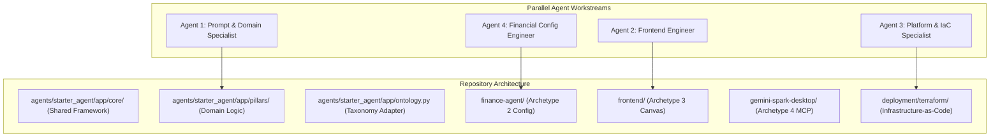
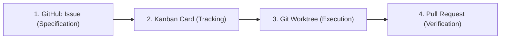
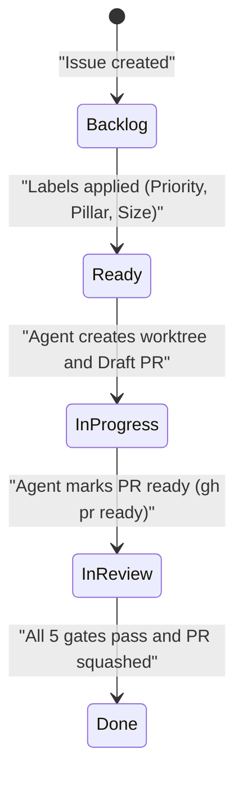

<!--
Copyright 2026 The Project Contributors

Licensed under the Apache License, Version 2.0 (the "License");
you may not use this file except in compliance with the License.
You may obtain a copy of the License at

    https://www.apache.org/licenses/LICENSE-2.0

Unless required by applicable law or agreed to in writing, software
distributed under the License is distributed on an "AS IS" BASIS,
WITHOUT WARRANTIES OR CONDITIONS OF ANY KIND, either express or implied.
See the License for the specific language governing permissions and
limitations under the License.
-->

# Multi-Agent Delivery Operating Model — Parallel Swarms & Collision Prevention

This document establishes the operational governance framework enabling autonomous AI coding agents and human software engineers to build, test, and ship features concurrently without branch collisions, overwritten changes, or architectural drift.

---

## Table of Contents

- [1. Executive Summary & Core Challenges](#1-executive-summary--core-challenges)
- [2. Architectural Decoupling for Parallel Delivery](#2-architectural-decoupling-for-parallel-delivery)
- [3. The 1:1:1:1 Delivery Lifecycle](#3-the-1111-delivery-lifecycle)
- [4. Swarm Isolation via Git Worktrees](#4-swarm-isolation-via-git-worktrees)
- [5. Conflict-Free File Ownership Boundaries](#5-conflict-free-file-ownership-boundaries)
- [6. Automated State Synchronization & Coordination](#6-automated-state-synchronization--coordination)
- [7. Quality Gates & Human Review Authority](#7-quality-gates--human-review-authority)

---

## 1. Executive Summary & Core Challenges

Scaling agentic software delivery introduces distinct failure modes:
1. **Branch Overwrites**: Two concurrent subagents modifying the same file in a shared working tree.
2. **Context Pollution**: Diagnostic test logs or scratch files generated by one agent interfering with another.
3. **Ghost Branches**: Agents abandoning partial work on branches without linking them to issues or Kanban cards.
4. **Silent Regressions**: Agents inadvertently degrading system behavior to pass narrow unit tests.

The **Multi-Agent Delivery Operating Model** eliminates these hazards through strict directory boundaries, isolated filesystem worktrees, automated Kanban card state tracking, and mandatory dual-review evaluation gates.

---

## 2. Architectural Decoupling for Parallel Delivery

The blueprint organizes services into modular, independent packages with clear composition roots:



Because each workstream targets isolated directories, multiple agents can open and merge pull requests simultaneously with zero merge conflicts.

---

## 3. The 1:1:1:1 Delivery Lifecycle

Every automated or human task progresses through the four-stage lifecycle:



1. **GitHub Issue**: Authors a single-scope change with clear acceptance criteria and priority.
2. **Kanban Card**: Automatically tracks progress from `Backlog` to `Ready`, `In Progress`, `In Review`, and `Done`.
3. **Git Worktree**: Provisions an isolated local workspace directory (`../wt-<ISSUE_ID>`) branching off `origin/main`.
4. **Pull Request**: Submits early Draft PR (`Fixes #<ISSUE_ID>`) and triggers the 5 CI verification gates.

---

## 4. Swarm Isolation via Git Worktrees

When delegating multiple sub-tasks to autonomous coding agents on the same workstation, **never** execute agents in the root repository folder. Use isolated git worktrees:

```bash
# Provision isolated worktree for Agent A
git worktree add ../agent-wt-feature-a -b feat/201-add-tool origin/main

# Provision isolated worktree for Agent B
git worktree add ../agent-wt-feature-b -b feat/202-update-dashboard origin/main
```

### Benefits of Worktree Isolation
- **Separate `.git/index`**: Each agent commits and pushes independently without staging collisions.
- **Scratch Discretion**: Scratch logs, intermediate files, and temporary environments do not leak into peer branches.
- **Instant Clean Teardown**: Completed worktrees are pruned with `git worktree remove` without affecting clean clones.

---

## 5. Conflict-Free File Ownership Boundaries

To ensure zero branch collisions, tasks are scoped to discrete file ownership domains:

| Subsystem | Directory Path | Authorized Change Scope |
| :--- | :--- | :--- |
| **Agent Core** | `agents/starter_agent/app/core/` | Base classes, telemetry, guardrails, and connection factories. |
| **Domain Pillars** | `agents/starter_agent/app/pillars/` | Specific agent capabilities, prompts, and tool implementations. |
| **Semantic Taxonomy** | `agents/starter_agent/app/ontology.py` | Business Glossary, Context Graph, and Dataplex mappings. |
| **Financial Agent** | `finance-agent/` | Personas, system instructions, and BYOS skill definitions. |
| **A2UI Frontend** | `frontend/` | Canvas UI, Nginx configuration, and postMessage event handlers. |
| **Desktop Extension** | `gemini-spark-desktop/` | macOS Seatbelt profiles, MCP client bridges, and scripts. |
| **Cloud Infrastructure**| `deployment/terraform/` | Terraform modules, variables, and policy guards. |

---

## 6. Automated State Synchronization & Coordination

The Kanban board automatically mirrors agent actions without manual card dragging:



1. **Card Claiming**: When an agent assigns an issue or pushes a branch matching `feat/<ID>-*`, the card moves to `In Progress`.
2. **Review Transition**: Converting a Draft PR to Ready for Review automatically moves the card to `In Review`.
3. **Auto-Closure**: Squash merging the PR closes the issue via `Fixes #<ID>` and transitions the card to `Done`.

---

## 7. Quality Gates & Human Review Authority

While autonomous agents construct code, human engineers maintain final merging authority:
- **Zero-Bypass Branch Protection**: GitHub branch protection strictly requires all 5 gates (`lint`, `terraform-plan`, `tests`, `evals`, `frontend-build`) to pass.
- **Non-Destructive Infrastructure Guard**: Any destructive change to stateful resources halts CI unless approved by an SRE.
- **LLM Judge Thresholds**: Quality regressions below calibrated thresholds cannot be overridden by agents.
