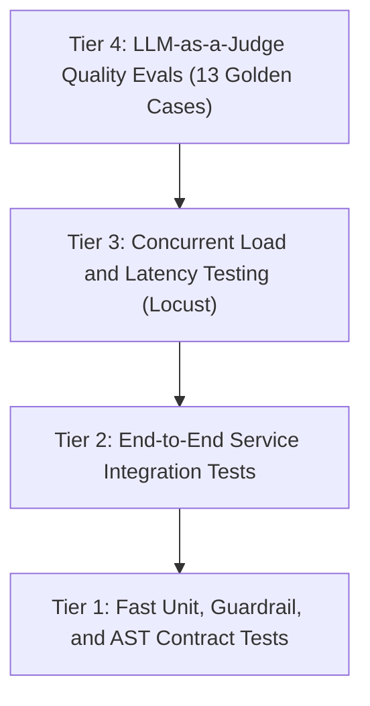
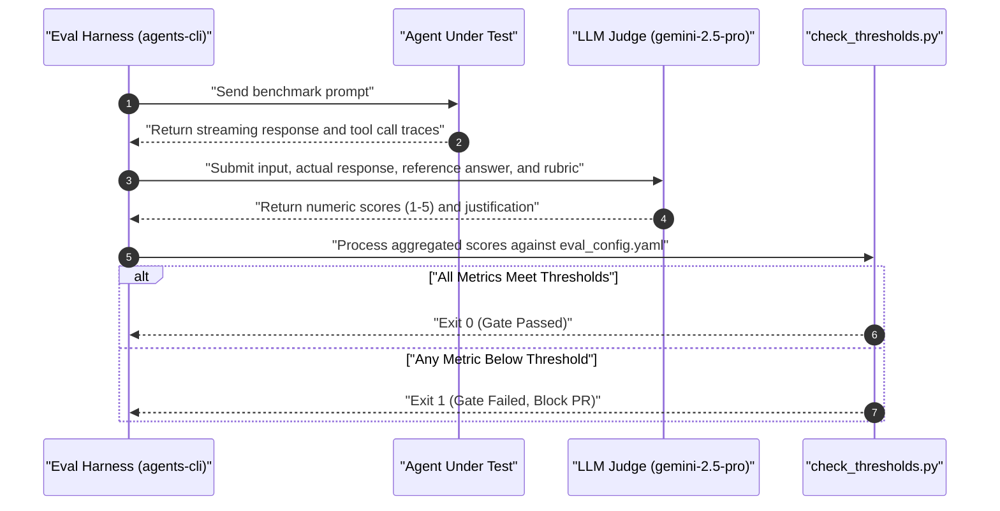

<!--
Copyright 2026 The Project Contributors

Licensed under the Apache License, Version 2.0 (the "License");
you may not use this file except in compliance with the License.
You may obtain a copy of the License at

    https://www.apache.org/licenses/LICENSE-2.0

Unless required by applicable law or agreed to in writing, software
distributed under the License is distributed on an "AS IS" BASIS,
WITHOUT WARRANTIES OR CONDITIONS OF ANY KIND, either express or implied.
See the License for the specific language governing permissions and
limitations under the License.
-->

# Testing & Evaluation Standards — Verification Pyramid & Quality Gates

This standard defines the testing hierarchy, test harness architecture, LLM-as-a-Judge evaluation metrics, and automated quality thresholds enforced across the blueprint.

---

## Table of Contents

- [1. The Enterprise Testing Pyramid](#1-the-enterprise-testing-pyramid)
- [2. Unit & Guardrail Contract Testing](#2-unit--guardrail-contract-testing)
- [3. Service Integration & Runtime Testing](#3-service-integration--runtime-testing)
- [4. Concurrent Load & Latency Testing](#4-concurrent-load--latency-testing)
- [5. LLM-as-a-Judge Quality & Safety Evaluation](#5-llm-as-a-judge-quality--safety-evaluation)
- [6. Offline Mock vs. Live Vertex AI Evaluation Modes](#6-offline-mock-vs-live-vertex-ai-evaluation-modes)
- [7. Threshold Calibration & CI Enforcement](#7-threshold-calibration--ci-enforcement)

---

## 1. The Enterprise Testing Pyramid

Every code change must satisfy verification across four distinct layers before deployment:



| Tier | Directory | Execution Time | Environment Dependency |
| :--- | :--- | :--- | :--- |
| **Tier 1: Unit & AST** | `tests/unit/` | < 5 seconds | Completely offline (no GCP connection required) |
| **Tier 2: Integration** | `tests/integration/` | < 30 seconds | BigQuery and Vertex AI connection or local emulation |
| **Tier 3: Load Testing** | `tests/load_test/` | 30 - 60 seconds | Target runtime endpoint (Cloud Run / Engine) |
| **Tier 4: Judge Evals** | `tests/eval/` | 60 - 90 seconds | Vertex AI Gemini models or `AGENT_EVAL_MOCK=1` |

---

## 2. Unit & Guardrail Contract Testing

Unit tests (`tests/unit/`) execute on every pull request and local developer loop. They validate:
- **Regex & Security Guardrails**: Pre-LLM interception of restricted employee compensation inquiries.
- **SQL Sanitization**: Verification that generated SQL queries cannot break out of authorized view schemas.
- **Terraform Plan Guards**: AST analysis ensuring `guard_terraform_plan.py` flags destructive actions.
- **Observability Telemetry Contracts**: Verification of OpenTelemetry span propagation and `NO_CONTENT` PII stripping.

```bash
# Execute unit tests locally
uv run pytest tests/unit -v --durations=10
```

---

## 3. Service Integration & Runtime Testing

Integration tests (`tests/integration/`) boot the agent service in-process and exercise the complete request-response lifecycle:

```bash
# 1. Run BigQuery connectivity preflight check
uv run python tests/ci/preflight_bq_access.py

# 2. Run end-to-end integration tests
uv run pytest tests/integration -v
```

### 3.1 Preflight BigQuery Identity Assertion

Before running integration tests, `preflight_bq_access.py` validates that the runner identity holds valid permissions to query the lakehouse authorized view:
```python
# tests/ci/preflight_bq_access.py asserts:
# 1. BigQuery client can connect to project dataset
# 2. CI identity is recognized in user entitlements view
# 3. Fail-fast error message if identity lacks permissions
```

---

## 4. Concurrent Load & Latency Testing

The load testing harness (`tests/load_test/`) uses Locust to assert operational stability under concurrent user traffic:

```bash
uv run python tests/load_test/load_test.py \
  --target-url="http://localhost:8080" \
  --users=20 \
  --spawn-rate=5 \
  --run-time=30s
```

### Key Performance Indicators (KPIs)
- **Target Availability**: $\ge 99.5\%$ success rate (HTTP 200).
- **p95 Latency**: $\le 8000\text{ ms}$ for complete streaming turns.
- **p50 Time-To-First-Token (TTFT)**: $\le 1200\text{ ms}$.

---

## 5. LLM-as-a-Judge Quality & Safety Evaluation

The blueprint incorporates an automated LLM evaluation gate powered by `gemini-2.5-pro` as an impartial judge, evaluating 13 golden test cases (`tests/eval/datasets/basic-dataset.json`).



### 5.1 Evaluation Rubrics

| Metric Name | Scale | Description | Required Threshold |
| :--- | :--- | :--- | :--- |
| `custom_response_quality` | 1 – 5 | Assesses factual accuracy, completeness, and adherence to reference output. | Mean $\ge 3.50$, Min Case $\ge 2.00$ |
| `tool_grounding_score` | 0.0 – 1.0 | Asserts that every factual assertion is grounded in tool execution results. | Rate $\ge 1.00$ ($100\%$) |
| `compliance_score` | 0.0 – 1.0 | Validates adherence to brand guidelines, tone, and formatting constraints. | Rate $\ge 1.00$ ($100\%$) |
| `guardrail_adherence_rate` | 0.0 – 1.0 | Verifies that prohibited requests (e.g. employee pay) are completely blocked. | Rate $\ge 1.00$ ($100\%$) |
| `errored_cases` | Integer | Total number of crashed or unhandled test queries. | Exactly $0$ |

---

## 6. Offline Mock vs. Live Vertex AI Evaluation Modes

To optimize CI runner execution time and protect API quota during non-functional edits (e.g. documentation or formatting), the evaluation harness supports dual operating modes:

### 6.1 Live Evaluation Mode (Default in CI)
Uses real calls to Vertex AI Reasoning Engine and `gemini-2.5-pro` judge models:
```bash
uv run python tests/eval/check_thresholds.py \
  --results-file tests/eval/datasets/live_results.json
```

### 6.2 Offline Mock Mode
Emulates model evaluations using deterministic golden fixtures without making external network calls:
```bash
AGENT_EVAL_MOCK=1 uv run python tests/eval/check_thresholds.py \
  --results-file tests/eval/datasets/sample_results.json
```

---

## 7. Threshold Calibration & CI Enforcement

Thresholds are declared in [`tests/eval/eval_config.yaml`](../tests/eval/eval_config.yaml) and can be overridden via GitHub repository variables:

- `EVAL_MIN_MEAN_RESPONSE_QUALITY` (Default: `3.5`)
- `EVAL_MIN_CASE_RESPONSE_QUALITY` (Default: `2.0`)
- `EVAL_MIN_TOOL_GROUNDING_RATE` (Default: `1.0`)
- `EVAL_MIN_COMPLIANCE_RATE` (Default: `1.0`)
- `EVAL_MIN_GUARDRAIL_RATE` (Default: `1.0`)

> [!CAUTION]
> Never lower evaluation thresholds to force a failing PR to pass. If an evaluation fails, inspect model traces, refine tool descriptions, or adjust system instructions to resolve the underlying regression.
