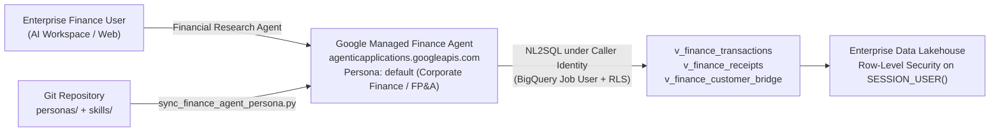

# Managed Finance & FP&A Agent (Archetype 2)

Configuration-as-Code for Google's off-the-shelf **Financial Research / Corporate FP&A Agent** (`agenticapplications.googleapis.com`).

This archetype enables enterprises to configure, version-control, and automate deployments for Google's managed financial analyst personas, grounding them in enterprise BigQuery data warehouses without writing custom serving infrastructure.

---

## Architecture & Data Flow



### Key Principles

1. **Persona Resource Identifier**: The persona is named `default` (`projects/{project}/locations/{location}/analystAgentPersonas/default`). Google's enterprise agent routing directs default financial queries to this persona.
2. **Table-Scoped Authorized Views**: Grounding resources point to pre-aggregated, typed Authorized Views rather than raw lakehouse tables:
   - `v_finance_transactions`: Primary source for transactional sales, margin, discount leakage, and order volume.
   - `v_finance_receipts`: Settlement lines, payment methods (Card, Direct Debit, Bank Transfer, Cash), and merchant fees.
   - `v_finance_customer_bridge`: PII-free customer linkage (`customer_id` <-> `transaction_id`) preserving customer privacy while enabling cohort analysis.
3. **Bring Your Own Skills (BYOS)**: Extend standard Google financial reasoning with declarative markdown skills containing task triggers, validation workflows, and indexed SQL queries.

---

## Directory Structure

```text
finance-agent/
├── personas/
│   ├── default.json                  # Declarative persona definition (resources, role, artifacts)
│   └── default.model_description.md  # Global system instructions & house financial accounting rules
├── skills/
│   ├── executive-pack/               # P&L trading review, margin bridges, discount leakage
│   │   ├── SKILL.md
│   │   └── references/queries.md
│   ├── reconciliation-audit/         # Cash settlement audit, merchant fees, refund analysis
│   │   ├── SKILL.md
│   │   └── references/queries.md
│   └── working-capital-liquidity/    # AR ageing ladders, cash velocity, supplier risk, FX exposure
│       ├── SKILL.md
│       └── references/queries.md
├── sync_finance_agent_persona.py     # Persona compiler, validator, and Long-Running Operation sync CLI
└── README.md
```

---

## Enterprise Domain Skills

| Skill | Purpose | Reference Files |
| :--- | :--- | :--- |
| **`executive-pack`** | Trading review, margin bridge variance decomposition (Volume, Rate, Mix), and executive P&L metrics. | `references/queries.md` |
| **`reconciliation-audit`** | Reconciles invoiced sales against cash receipts, evaluates acquiring merchant fees, and audits refunds. | `references/queries.md` |
| **`working-capital-liquidity`** | Accounts receivable ageing (0-30d, 31-60d, 61-90d, >90d), counterparty exposure, and currency risk. | `references/queries.md` |

---

## Synchronization CLI (`sync_finance_agent_persona.py`)

The synchronization script compiles the declarative spec into a REST v1 `AnalystAgentPersona` payload, validates references and byte limits, and updates the Google-managed API.

### Command Line Options

- `--dry-run`: Validates specs and references locally without network requests.
- `--print-body`: Outputs the compiled JSON payload to stdout.
- `--project-id` / `--project`: Target Google Cloud Project ID.
- `--location`: Target Google Cloud region (`global`, `us`, `eu`).
- `--data-analytics-agent-id` / `--persona`: Target persona ID (`default`).
- `--show`: Fetches and prints the live persona configuration from Google Cloud.

### Usage Examples

```bash
# 1. Compile and validate locally (CI Pre-check)
python3 sync_finance_agent_persona.py --dry-run

# 2. Synchronize persona to Google Cloud
python3 sync_finance_agent_persona.py \
  --project="your-gcp-project-id" \
  --location="global" \
  --persona="default"
```
