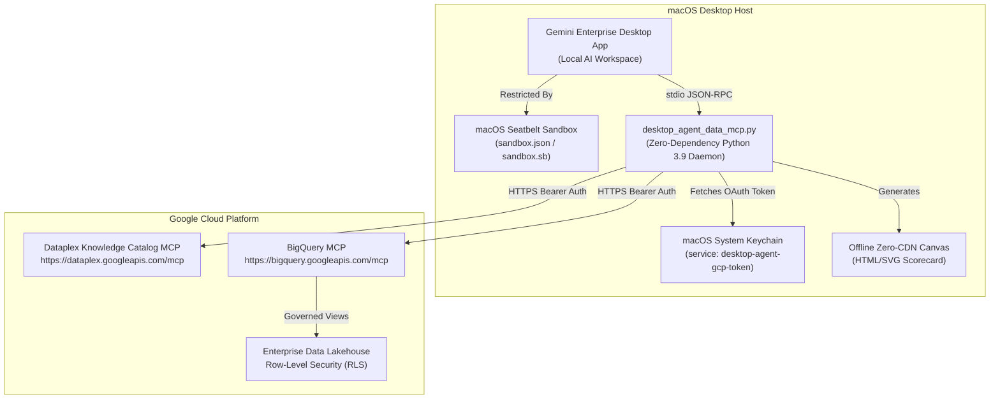

# Local macOS Desktop Extension (Archetype 4)

Local macOS workspace extension kit for **Gemini Enterprise Desktop (`Gemini Enterprise.app`)** and **Spark Desktop Environments**.

This archetype equips local desktop agent runtimes with governed access to enterprise data lakes (BigQuery) and data catalogs (Dataplex) via lightweight Model Context Protocol (MCP) bridges, while enforcing OS-level sandboxing, credential security, and zero-CDN rendering.

---

## Architectural Highlights



### Security & Isolation Controls

1. **Host Sandboxing (Seatbelt)**:
   - Configured via `sandbox.json` and `scripts/sandbox.sb`.
   - Denies broad disk access; restricts file operations to the designated agent workspace and temporary caches (`/private/tmp`, `/Users/*/Library/Caches`).
   - Egress networking is limited to outbound HTTPS (port 443) for GCP API communication and loopback (localhost) for local MCP IPC.
2. **Zero Plaintext Secrets**:
   - Access tokens are never stored in `.env` files or workspace folders.
   - Authentication tokens are maintained securely in the macOS System Keychain via `/usr/bin/security add-generic-password` under the service name `desktop-agent-gcp-token`.
3. **Zero-Dependency Python 3.9+ Bridge**:
   - `desktop_agent_data_mcp.py` relies exclusively on the Python standard library (`urllib`, `json`, `ssl`, `subprocess`).
   - Runs out-of-the-box on standard macOS system Python (`/usr/bin/python3`) without virtual environment bootstrapping or third-party packages.
4. **Offline Zero-CDN Canvas Rendering**:
   - Dashboards and shift pacing scorecards are compiled into self-contained HTML/SVG documents.
   - No external JavaScript libraries, CSS frameworks, or font CDNs are referenced, ensuring reliable visualization in restricted enterprise networks.

---

## Directory Contents

```text
gemini-spark-desktop/
├── install_on_mac.sh                  # One-command installer configuring ~/.ge_spark and ~/.gemini
├── desktop_agent_data_mcp.py          # Python 3.9 zero-dependency CLI & stdio MCP bridge
├── AGENTS.md                          # Desktop workspace governance & remuneration guardrails
├── USER.md                            # Operational supervisor persona & daily routine memory
├── skills/
│   └── daily-huddle-assistant/
│       └── SKILL.md                   # Daily morning briefing & pacing scorecard skill
├── scripts/
│   ├── sandbox.sb                     # macOS Seatbelt sandbox profile definition
│   └── verify_desktop_env.sh          # Pre-flight environment check (sandbox-exec, security CLI)
└── README.md
```

---

## Desktop Extension Skills

### `daily-huddle-assistant`
Automates morning shift operations:
- Runs an all-in-one health check via `desktop_agent_data_mcp.py --cli morning-snapshot`.
- Queries BigQuery lakehouse views (`v_operations`, `v_catalog_enriched`, `v_finance_transactions`).
- Generates a time-blocked schedule with inline `flowchart LR` visualization.
- Emits a standalone zero-CDN HTML scorecard (`~/operational_shift_canvas.html`) for interactive review in the desktop canvas panel.

---

## Quickstart & Installation

### 1. Verify macOS Host Environment

```bash
cd gemini-spark-desktop
bash scripts/verify_desktop_env.sh
```

### 2. Run Workspace Installer

```bash
./install_on_mac.sh
```

This sets up:
- Workspace directories (`~/ge_spark_workspace/.ge_spark` and `~/gemini_workspace/.gemini`).
- The Seatbelt configuration file (`sandbox.json`).
- The MCP server configuration in `mcp_servers.json`.
- Skill definitions and persona governance profiles.

### 3. Verify MCP Data Bridge

```bash
# Test direct CLI execution
/usr/bin/python3 desktop_agent_data_mcp.py --cli morning-snapshot --json

# Generate zero-CDN HTML scorecard
/usr/bin/python3 desktop_agent_data_mcp.py --cli morning-snapshot --render-canvas
```
